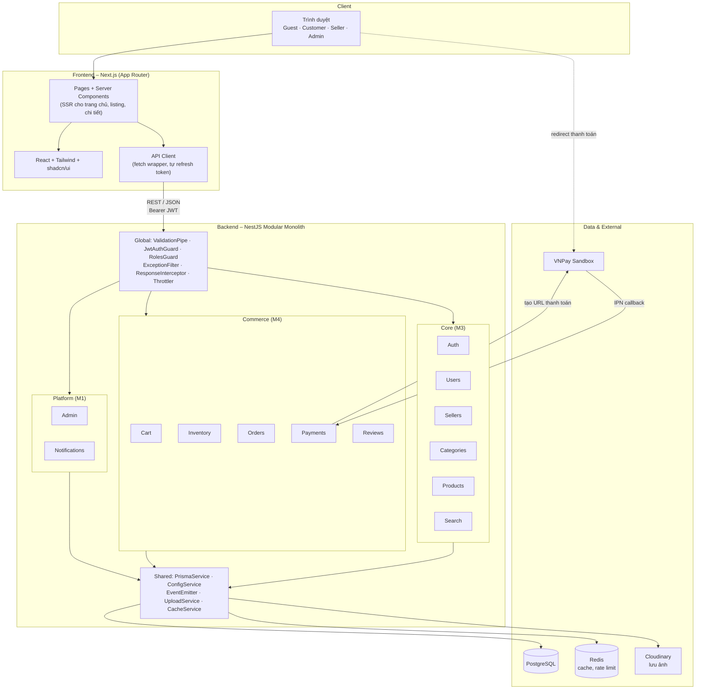
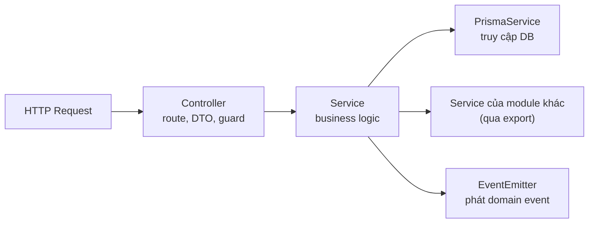
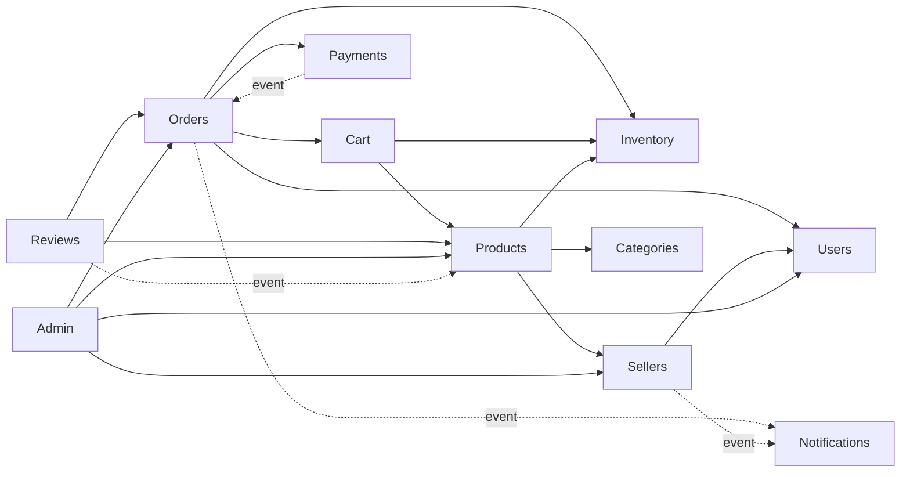

# 03 – System Architecture

## 1. Lựa chọn kiến trúc: Modular Monolith

Backend là **một ứng dụng NestJS duy nhất**, chia thành các module nghiệp vụ độc lập, dùng chung một database PostgreSQL.

| Tiêu chí | Modular Monolith (chọn) | Microservices |
|----------|-------------------------|---------------|
| Triển khai | 1 container backend | Nhiều service, cần API gateway, service discovery |
| Transaction | Transaction database thông thường | Phải dùng saga, eventual consistency |
| Debug | Một process, một log | Phân tán, khó truy vết |
| Phù hợp nhóm 4 sinh viên, 8 tuần | Có | Không |

Checkout cần trừ kho, tạo đơn, xóa giỏ trong **một transaction**. Với monolith việc này là một lệnh `prisma.$transaction`; với microservices sẽ tốn nhiều tuần chỉ để làm đúng.

Để sau này tách service được, các module tuân theo quy tắc ở mục 4.

## 2. System Architecture Diagram



## 3. Các tầng trong một module backend



| Tầng | Trách nhiệm | Không được làm |
|------|-------------|----------------|
| Controller | Khai báo route, nhận DTO, gắn guard/role, gọi service | Chứa business logic, gọi Prisma |
| DTO | Định nghĩa và validate input bằng `class-validator` | – |
| Service | Business logic, kiểm tra quyền sở hữu, transaction | Phụ thuộc vào `Request`/`Response` của HTTP |
| PrismaService | Truy vấn database | – |

Với quy mô này, service gọi Prisma trực tiếp, không thêm tầng repository. Thêm repository chỉ làm tăng số file mà nhóm chưa cần.

## 4. Quy tắc phụ thuộc giữa các module

1. **Mỗi module chỉ đọc/ghi các bảng của mình.** Cần dữ liệu của module khác thì gọi service mà module đó export. Ví dụ: `OrdersService` gọi `InventoryService.decrease()`, không tự `prisma.inventory.update()`.
2. **Ngoại lệ:** truy vấn chỉ đọc có join (ví dụ Admin thống kê, Search) được phép `include` bảng khác.
3. **Tác vụ phụ dùng event.** Module phát event, module khác lắng nghe; bên phát không biết bên nghe. Dùng `@nestjs/event-emitter`.
4. **Không phụ thuộc vòng.** Nếu A cần B và B cần A, chuyển một chiều thành event.
5. **Transaction xuyên module:** service nhận tham số `tx` (Prisma transaction client) tùy chọn để tham gia transaction của bên gọi.

Sơ đồ phụ thuộc cho phép:



Domain event dùng trong MVP:

| Event | Phát từ | Lắng nghe | Tác dụng |
|-------|---------|-----------|----------|
| `seller.approved`, `seller.rejected` | Sellers | Notifications | Báo cho người đăng ký |
| `order.created` | Orders | Notifications | Báo cho từng Seller có đơn mới |
| `seller-order.status-changed` | Orders | Notifications | Báo cho Customer |
| `payment.succeeded` | Payments | Orders, Notifications | Order → PROCESSING; báo Customer |
| `payment.failed`, `payment.expired` | Payments | Orders, Notifications | Hủy đơn và hoàn kho (khi hết hạn) |
| `review.created`, `review.updated` | Reviews | Products | Tính lại `rating_avg`, `rating_count` |

## 5. Cấu trúc repository (monorepo)

Một repo duy nhất để PR có thể thay đổi đồng thời API và tài liệu, và để Docker Compose chạy toàn bộ.

`apps/api` và `apps/web` là hai project npm độc lập, mỗi project có `package.json`, `node_modules` và `package-lock.json` riêng. Nhóm không dùng npm workspaces: project do công cụ khởi tạo của NestJS 12 sinh ra gọi Jest qua đường dẫn `./node_modules/jest`, và đường dẫn đó không còn đúng khi workspaces gom thư viện lên thư mục gốc.

Cây dưới đây là cấu trúc đích. Các thư mục trong cây đã được tạo sẵn; mỗi thư mục lá chứa một file `.gitkeep` rỗng để Git giữ lại thư mục trống. Các file (`main.ts`, `app.module.ts`, `schema.prisma`, `seed.ts`, `docker-compose.yml`, workflow CI) do các task khởi tạo T-02, T-06 đến T-09 tạo ra, theo [apps/README.md](../apps/README.md). Khi một thư mục đã có file thật, xóa file `.gitkeep` của thư mục đó.

```
marketplace/
├── apps/
│   ├── api/                          # NestJS
│   │   ├── prisma/
│   │   │   ├── schema.prisma         # owner: M1
│   │   │   ├── migrations/
│   │   │   └── seed.ts
│   │   ├── src/
│   │   │   ├── main.ts
│   │   │   ├── app.module.ts         # owner: M1
│   │   │   ├── common/               # guards, decorators, filters, interceptors, pipes
│   │   │   ├── config/
│   │   │   ├── prisma/               # PrismaModule
│   │   │   └── modules/
│   │   │       ├── auth/
│   │   │       ├── users/
│   │   │       ├── sellers/
│   │   │       ├── categories/
│   │   │       ├── products/         # gồm cả search
│   │   │       ├── inventory/
│   │   │       ├── cart/
│   │   │       ├── orders/
│   │   │       ├── payments/
│   │   │       ├── reviews/
│   │   │       ├── notifications/
│   │   │       └── admin/
│   │   └── test/                     # integration test
│   └── web/                          # Next.js
│       └── src/
│           ├── app/
│           │   ├── (shop)/           # trang chủ, products, cart, checkout, orders, account
│           │   ├── (auth)/           # login, register
│           │   ├── seller/           # Seller Center
│           │   └── admin/            # Admin Dashboard
│           ├── components/
│           │   ├── ui/               # shadcn/ui
│           │   └── <feature>/
│           ├── lib/                  # api client, utils
│           ├── hooks/
│           └── types/
├── e2e/                              # Playwright
├── docs/
├── .github/                          # workflows, PR/Issue template
├── docker-compose.yml
└── README.md
```

Mỗi ứng dụng có file `.env.example` riêng (doc 09 mục 3).

Cấu trúc bên trong một module backend:

```
modules/products/
├── products.module.ts
├── products.controller.ts
├── products.service.ts
├── products.service.spec.ts
└── dto/
    ├── create-product.dto.ts
    ├── update-product.dto.ts
    └── query-product.dto.ts
```

## 6. Đặc tả module

Mỗi module dưới đây nêu mục tiêu, entity, business logic và lỗi chính. API chi tiết ở [05_API_Documentation.md](05_API_Documentation.md); cấu trúc bảng ở [04_Database_Design.md](04_Database_Design.md); yêu cầu test ở [08_Testing_Plan.md](08_Testing_Plan.md).

### 6.1 Authentication (M3)

- **Mục tiêu:** xác thực danh tính và cấp token.
- **Entities:** `users`, `roles`, `user_roles`, `refresh_tokens`.
- **Business logic:**
  - Access token JWT sống 15 phút, payload `{ sub, email, roles }`, gửi qua header `Authorization: Bearer`.
  - Refresh token là chuỗi ngẫu nhiên, sống 7 ngày, gửi qua cookie `httpOnly`, `sameSite=lax`, `secure` ở production. Database chỉ lưu SHA-256 của token.
  - Rotation: mỗi lần refresh thu hồi token cũ, cấp token mới. Dùng lại token đã thu hồi thì thu hồi toàn bộ token của user đó.
  - `JwtAuthGuard` áp dụng toàn cục; route công khai đánh dấu `@Public()`. `RolesGuard` đọc `@Roles(...)`.
- **Validation:** email hợp lệ; mật khẩu ≥ 8 ký tự, có chữ và số.
- **Lỗi chính:** `EMAIL_ALREADY_EXISTS` (409), `INVALID_CREDENTIALS` (401), `ACCOUNT_BANNED` (403), `INVALID_REFRESH_TOKEN` (401).

### 6.2 User Management (M3)

- **Mục tiêu:** quản lý hồ sơ và sổ địa chỉ.
- **Entities:** `users`, `addresses`.
- **Business logic:** chỉ một địa chỉ mặc định mỗi user; địa chỉ đầu tiên tự thành mặc định; xóa địa chỉ mặc định thì địa chỉ mới nhất còn lại lên thay. Tối đa 10 địa chỉ.
- **Lỗi chính:** `WRONG_PASSWORD` (400), `ADDRESS_NOT_FOUND` (404), `ADDRESS_LIMIT_REACHED` (400).

### 6.3 Seller Management (M3)

- **Mục tiêu:** quy trình trở thành người bán và quản lý store.
- **Entities:** `sellers`, `stores`.
- **Business logic:** đăng ký tạo `sellers` (PENDING) và `stores` trong một transaction. Duyệt thì gán role SELLER. SUSPENDED thì sản phẩm của store không hiện trong search, đơn đang xử lý vẫn tiếp tục. Slug store sinh từ tên, thêm hậu tố nếu trùng.
- **Lỗi chính:** `SELLER_ALREADY_REGISTERED` (409), `SELLER_NOT_APPROVED` (403), `INVALID_SELLER_STATUS` (409).

### 6.4 Category Management (M3)

- **Mục tiêu:** tổ chức sản phẩm theo cây danh mục.
- **Entities:** `categories`.
- **Business logic:** tối đa 2 cấp; danh mục có con không nhận sản phẩm; không xóa khi còn con hoặc còn sản phẩm. Cây danh mục được cache Redis 10 phút, xóa cache khi Admin thay đổi.
- **Lỗi chính:** `CATEGORY_HAS_CHILDREN` (409), `CATEGORY_HAS_PRODUCTS` (409), `CATEGORY_DEPTH_EXCEEDED` (400).

### 6.5 Product Management (M3)

- **Mục tiêu:** Seller đăng bán và quản lý sản phẩm.
- **Entities:** `products`, `product_variants`, `product_images` (tạo kèm `inventory` qua `InventoryService`).
- **Business logic:**
  - Mọi sản phẩm có ít nhất một variant. Sản phẩm không có biến thể vẫn có một variant mặc định. Nhờ vậy Cart, Inventory, Order chỉ làm việc với `variant_id`.
  - `min_price` trên `products` được tính lại khi variant thay đổi, phục vụ lọc và sắp xếp theo giá.
  - Chuyển sang ACTIVE yêu cầu ≥ 1 ảnh và ≥ 1 variant đang bật. Sản phẩm BANNED chỉ Admin đổi được.
  - Upload ảnh: backend nhận file (Multer), kiểm tra loại và kích thước, đẩy lên Cloudinary, lưu `url` và `public_id`.
- **Lỗi chính:** `PRODUCT_NOT_FOUND` (404, gồm cả trường hợp sản phẩm thuộc store khác), `DUPLICATE_SKU` (409), `PRODUCT_NOT_PUBLISHABLE` (400), `INVALID_FILE` (400).

### 6.6 Search và Filtering (M3)

- **Mục tiêu:** giúp người mua tìm sản phẩm.
- **Triển khai:** nằm trong module `products`, là endpoint `GET /api/products`. Dùng PostgreSQL với extension `unaccent` và `pg_trgm` để tìm không dấu. Không dùng Elasticsearch.
- **Business logic:** chỉ trả sản phẩm ACTIVE, chưa xóa, thuộc store của Seller APPROVED. Lọc danh mục cha bao gồm danh mục con. Sắp xếp luôn kèm `id` làm khóa phụ để phân trang ổn định.
- **Lỗi chính:** `VALIDATION_ERROR` (400) khi tham số sai.

### 6.7 Inventory Management (M4)

- **Mục tiêu:** đảm bảo số lượng tồn kho chính xác.
- **Entities:** `inventory`.
- **Business logic:**
  - `decrease(tx, variantId, qty)` thực hiện `UPDATE inventory SET quantity = quantity - :qty WHERE variant_id = :id AND quantity >= :qty`. Nếu không có dòng nào bị ảnh hưởng thì ném `INSUFFICIENT_STOCK`. Cách này an toàn với truy cập đồng thời mà không cần khóa tường minh.
  - `increase(tx, variantId, qty)` dùng khi hoàn kho.
  - Khi trừ kho cho nhiều variant, sắp xếp theo `variant_id` trước để tránh deadlock.
- **Lỗi chính:** `INSUFFICIENT_STOCK` (409), `VARIANT_NOT_FOUND` (404, gồm cả trường hợp variant thuộc store khác).

### 6.8 Shopping Cart (M4)

- **Mục tiêu:** lưu sản phẩm khách định mua.
- **Entities:** `carts`, `cart_items`.
- **Business logic:** cart tạo lười (lần đầu thêm hàng). Giỏ không lưu giá; giá luôn đọc từ variant hiện tại. Mỗi item trả về kèm cờ `available` và `stock`. Tối đa 50 dòng trong giỏ.
- **Lỗi chính:** `VARIANT_NOT_AVAILABLE` (400), `INSUFFICIENT_STOCK` (409), `CANNOT_BUY_OWN_PRODUCT` (400), `CART_ITEM_NOT_FOUND` (404).

### 6.9 Order Management (M4)

- **Mục tiêu:** chuyển giỏ hàng thành đơn hàng và theo dõi vòng đời đơn.
- **Entities:** `orders`, `seller_orders`, `order_items`.
- **Business logic – checkout** (trong một transaction):
  1. Đọc các cart item được chọn; kiểm tra variant và sản phẩm còn bán.
  2. Kiểm tra địa chỉ thuộc về user.
  3. Nhóm item theo store.
  4. Trừ kho từng variant qua `InventoryService.decrease`.
  5. Tạo `orders`, các `seller_orders`, các `order_items` (snapshot tên, giá, ảnh).
  6. Tạo bản ghi `payments` qua `PaymentsService`.
  7. Xóa các cart item đã mua.
  8. Sau khi commit, phát `order.created`.
- **State machine:** định nghĩa bằng bảng chuyển trạng thái hợp lệ trong code, xem doc 04 mục 5. Hủy đơn thì hoàn kho trong cùng transaction.
- **Lỗi chính:** `CART_EMPTY` (400), `INSUFFICIENT_STOCK` (409), `ORDER_NOT_FOUND` (404), `INVALID_STATUS_TRANSITION` (409), `ORDER_NOT_PAID` (409).

### 6.10 Payment (M4)

- **Mục tiêu:** ghi nhận thanh toán cho đơn hàng.
- **Entities:** `payments`.
- **Business logic:**
  - Interface `PaymentProvider { createPaymentUrl(); verifyCallback(); }` với hai cài đặt: `CodProvider`, `VnpayProvider`. Thêm cổng mới không đụng đến `OrdersService`.
  - COD: payment PENDING, order sang PROCESSING ngay; payment thành PAID khi tất cả seller order của đơn đã giao.
  - VNPay: tạo URL có chữ ký, khách được chuyển hướng sang VNPay. Kết quả chính thức đến qua IPN; trang return chỉ để hiển thị.
  - IPN: kiểm tra chữ ký → kiểm tra số tiền → nếu payment đã PAID thì trả thành công mà không làm gì thêm (idempotent).
  - Cron mỗi phút tìm payment PENDING quá `expires_at`, đánh dấu EXPIRED và phát event để hủy đơn.
  - Không nhận và không lưu dữ liệu thẻ.
- **Lỗi chính:** `PAYMENT_NOT_FOUND` (404), `PAYMENT_EXPIRED` (409), `ORDER_ALREADY_PAID` (409), `INVALID_SIGNATURE` (400).

### 6.11 Review và Rating (M4)

- **Mục tiêu:** người mua thật đánh giá sản phẩm.
- **Entities:** `reviews`.
- **Business logic:** review gắn với `order_item_id` nên chỉ người đã mua mới đánh giá được và mỗi lần mua một đánh giá. `rating_avg`, `rating_count` lưu sẵn trên `products`, tính lại qua event.
- **Lỗi chính:** `REVIEW_NOT_ALLOWED` (403), `REVIEW_ALREADY_EXISTS` (409), `REVIEW_EDIT_EXPIRED` (403).

### 6.12 Admin Dashboard (M1)

- **Mục tiêu:** công cụ quản trị và thống kê.
- **Entities:** không có bảng riêng; đọc từ các bảng khác.
- **Business logic:** thao tác thay đổi dữ liệu (khóa user, duyệt seller, ban sản phẩm, hủy đơn) gọi service của module sở hữu. Thống kê dùng truy vấn aggregate; doanh thu chỉ tính seller order COMPLETED. Kết quả tổng quan cache Redis 5 phút.
- **Lỗi chính:** `FORBIDDEN` (403), `CANNOT_BAN_SELF` (400).

### 6.13 Notification (M1)

- **Mục tiêu:** báo cho người dùng các sự kiện liên quan.
- **Entities:** `notifications`.
- **Business logic:** chỉ lắng nghe event và ghi vào bảng. Lỗi khi tạo thông báo được log lại, không làm hỏng nghiệp vụ chính. Frontend polling số chưa đọc mỗi 30 giây.
- **Lỗi chính:** `NOTIFICATION_NOT_FOUND` (404).

## 7. Kiến trúc frontend

| Khu vực | Route | Kỹ thuật render | Lý do |
|---------|-------|-----------------|-------|
| Trang chủ, listing, chi tiết sản phẩm, trang store | `/`, `/products`, `/products/[slug]`, `/stores/[slug]` | Server Components (SSR) | SEO, tải nhanh |
| Giỏ hàng, checkout, tài khoản, đơn hàng | `/cart`, `/checkout`, `/account/*`, `/orders/*` | Client Components | Dữ liệu riêng tư, tương tác nhiều |
| Seller Center | `/seller/*` | Client Components | Ứng dụng quản trị |
| Admin Dashboard | `/admin/*` | Client Components | Ứng dụng quản trị |

- **Gọi API:** một wrapper duy nhất trong `lib/api.ts`, tự gắn access token, tự gọi `/auth/refresh` khi gặp 401 rồi thử lại một lần.
- **Lưu token:** access token giữ trong bộ nhớ (React context), refresh token nằm trong cookie httpOnly. Không lưu token vào `localStorage`.
- **Server state:** TanStack Query (cache, refetch, trạng thái loading/lỗi).
- **Form:** React Hook Form + Zod.
- **Bảo vệ route:** `middleware.ts` kiểm tra sự tồn tại của cookie để chuyển hướng sớm; quyền thật sự do backend quyết định.

## 8. Bảo mật

| Mối nguy | Biện pháp |
|----------|-----------|
| Lộ mật khẩu | bcrypt; không log mật khẩu; không trả hash trong response |
| Token bị đánh cắp qua XSS | Access token ngắn hạn, giữ trong bộ nhớ; refresh token httpOnly |
| CSRF trên `/auth/refresh` | Cookie `sameSite=lax`, CORS whitelist origin của frontend |
| IDOR (xem/sửa dữ liệu người khác) | Mọi truy vấn theo id đều kèm điều kiện chủ sở hữu trong service |
| SQL injection | Prisma; truy vấn raw dùng tham số hóa |
| Brute force | `@nestjs/throttler` trên login, register |
| Upload file độc hại | Kiểm tra MIME và kích thước; file lưu ở Cloudinary |
| Giả mạo callback thanh toán | Kiểm tra chữ ký HMAC và số tiền |
| Lộ secret | Biến môi trường; `.env` không commit |

## 9. Caching với Redis

Redis là tùy chọn, hệ thống vẫn chạy đúng khi không có cache. Chỉ cache dữ liệu đọc nhiều, ít thay đổi:

| Dữ liệu | Key | TTL | Xóa khi |
|---------|-----|-----|---------|
| Cây danh mục | `categories:tree` | 10 phút | Admin sửa danh mục |
| Thống kê Admin | `admin:stats:overview` | 5 phút | Hết hạn |
| Rate limit | do throttler quản lý | – | – |

Không cache giỏ hàng, tồn kho, đơn hàng.
