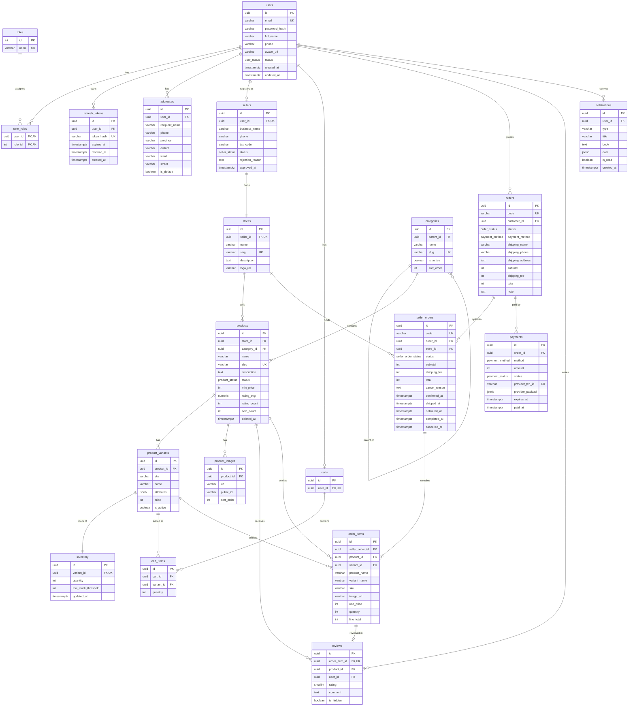
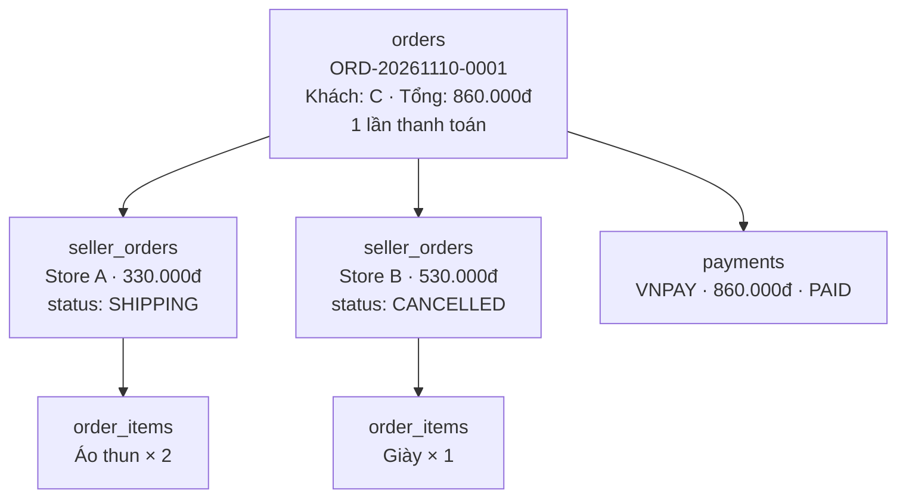
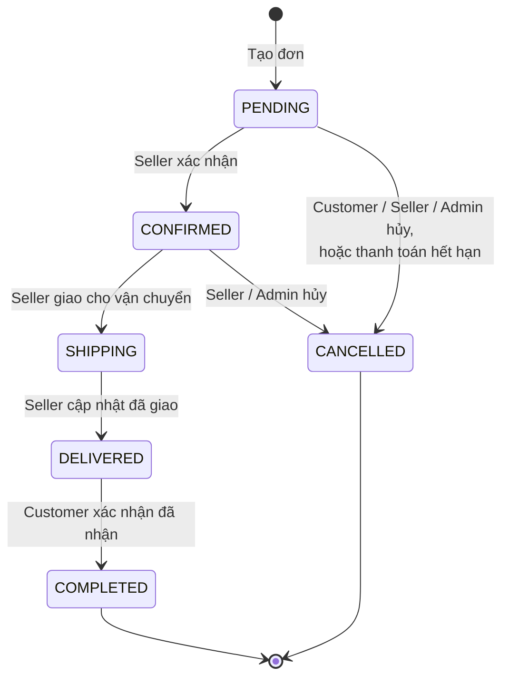
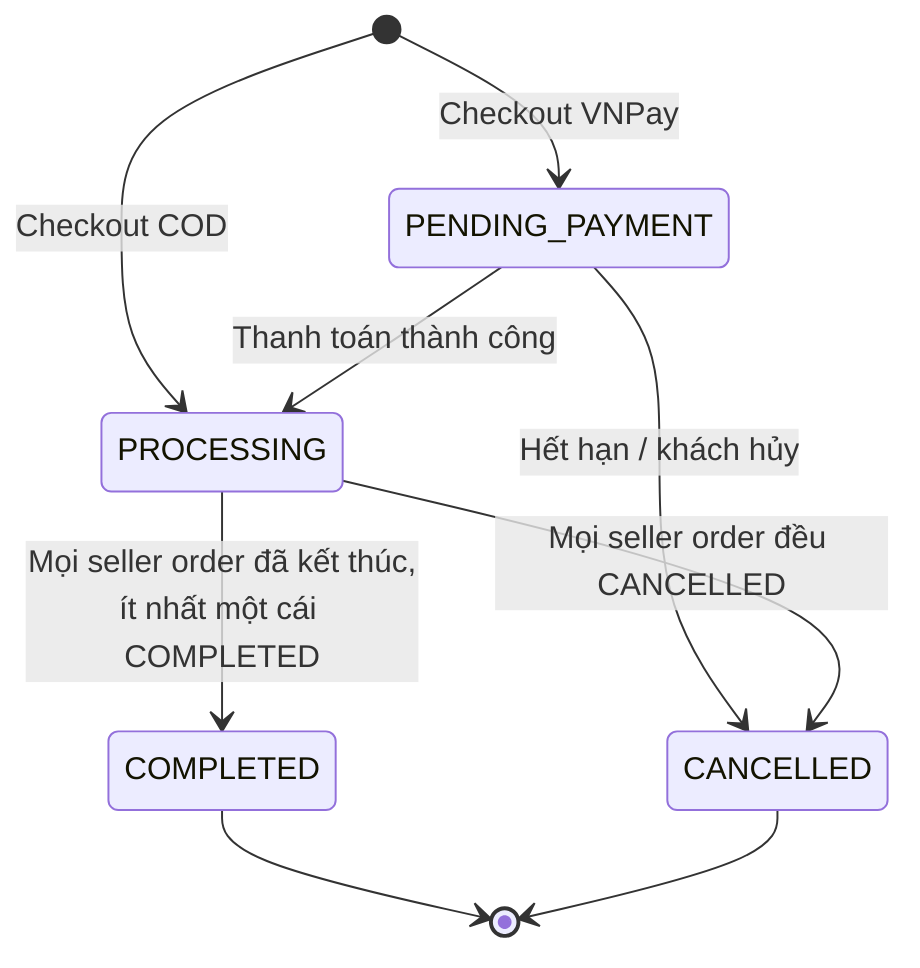
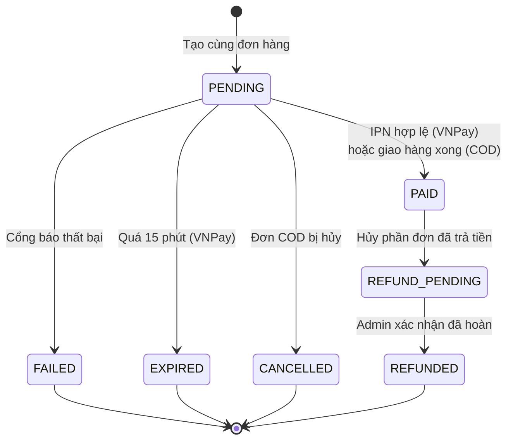

# 04 – Database Design

Hệ quản trị: PostgreSQL. ORM: Prisma. Tài liệu này là nguồn tham chiếu để viết `schema.prisma`; khi schema thay đổi phải cập nhật tài liệu trong cùng Pull Request.

## 1. Quy ước chung

| Hạng mục | Quy ước | Lý do |
|----------|---------|-------|
| Tên bảng, cột | `snake_case`, bảng số nhiều; trong Prisma dùng `@@map` / `@map` để model vẫn là `camelCase` | Theo thông lệ của PostgreSQL và TypeScript |
| Primary key | `id UUID` sinh bằng `gen_random_uuid()` | Không lộ số lượng bản ghi qua URL, khó đoán |
| Tiền tệ | `INTEGER`, đơn vị VND | VND không có phần thập phân; tránh sai số số thực. Giới hạn: tổng một đơn < 2 tỷ đồng (validate ở checkout) |
| Thời gian | `TIMESTAMPTZ`; mọi bảng có `created_at`, bảng sửa được có `updated_at` | Tránh lỗi múi giờ |
| Trạng thái | PostgreSQL `ENUM` (Prisma `enum`) | Database tự chặn giá trị sai |
| Xóa | Soft delete (`deleted_at`) cho `products`; các bảng khác xóa thật hoặc dùng trạng thái | Đơn hàng cũ vẫn tham chiếu được sản phẩm |
| Foreign key | Luôn khai báo tường minh kèm hành vi `ON DELETE` | Toàn vẹn dữ liệu |

## 2. ERD



So với danh sách entity dự kiến ban đầu (17 bảng), thiết kế bổ sung 3 bảng:

| Bảng thêm | Lý do |
|-----------|-------|
| `user_roles` | Bảng trung gian cho quan hệ N-N giữa `users` và `roles` |
| `refresh_tokens` | Cần để logout và xoay vòng refresh token |
| `seller_orders` | Cần để hỗ trợ đơn hàng nhiều Seller (mục 4) |

## 3. Phân tích quan hệ

### 3.1 Quan hệ 1-1

| Quan hệ | Cách cài đặt | Giải thích |
|---------|--------------|------------|
| `users` – `sellers` | `sellers.user_id` UNIQUE | Một tài khoản có tối đa một hồ sơ người bán. Tách bảng vì đa số user không phải seller, và hồ sơ seller có vòng đời duyệt riêng |
| `sellers` – `stores` | `stores.seller_id` UNIQUE | `sellers` chứa thông tin nội bộ (pháp lý, trạng thái duyệt); `stores` chứa thông tin công khai. Tách ra để API công khai không vô tình lộ thông tin nội bộ. Nếu sau này cho phép một seller nhiều store, chỉ cần bỏ ràng buộc UNIQUE |
| `users` – `carts` | `carts.user_id` UNIQUE | Mỗi khách một giỏ hàng |
| `product_variants` – `inventory` | `inventory.variant_id` UNIQUE | Tồn kho thay đổi rất thường xuyên và cần cập nhật có điều kiện; tách bảng giúp cập nhật kho không khóa dòng variant và phân rõ quyền sở hữu module (Product của M3, Inventory của M4) |
| `order_items` – `reviews` | `reviews.order_item_id` UNIQUE | Mỗi lần mua được đánh giá một lần |

### 3.2 Quan hệ 1-N

| Bên 1 | Bên N | ON DELETE | Ghi chú |
|-------|-------|-----------|---------|
| `users` | `addresses`, `refresh_tokens`, `notifications` | CASCADE | Dữ liệu phụ thuộc hoàn toàn vào user |
| `users` | `orders`, `reviews` | RESTRICT | Không xóa user đã có giao dịch; dùng `status = BANNED` |
| `categories` | `categories` (con) | RESTRICT | Tự tham chiếu qua `parent_id` |
| `categories` | `products` | RESTRICT | Không xóa danh mục còn sản phẩm |
| `stores` | `products`, `seller_orders` | RESTRICT | |
| `products` | `product_variants`, `product_images` | CASCADE | Trên thực tế sản phẩm chỉ soft delete |
| `carts` | `cart_items` | CASCADE | |
| `product_variants` | `cart_items` | CASCADE | Variant bị xóa thì biến mất khỏi giỏ |
| `orders` | `seller_orders` | RESTRICT | |
| `seller_orders` | `order_items` | RESTRICT | |
| `product_variants`, `products` | `order_items` | RESTRICT | Lịch sử đơn hàng phải còn nguyên; đây là lý do sản phẩm chỉ soft delete và variant đã bán chỉ được tắt `is_active` |
| `orders` | `payments` | RESTRICT | Một đơn có thể có nhiều lần thử thanh toán; tối đa một bản ghi PAID |
| `products` | `reviews` | RESTRICT | `product_id` lưu lặp trên `reviews` để truy vấn review theo sản phẩm không phải join 3 bảng |

### 3.3 Quan hệ N-N

| Quan hệ | Bảng trung gian | Giải thích |
|---------|-----------------|------------|
| `users` – `roles` | `user_roles` | Một người có thể vừa là CUSTOMER vừa là SELLER. Dùng bảng thay vì một cột enum để thêm/bớt role không cần đổi cấu trúc |
| `carts` – `product_variants` | `cart_items` (có thêm `quantity`) | |
| `orders` – `product_variants` | `seller_orders` → `order_items` | Bảng trung gian mang dữ liệu snapshot |

## 4. Thiết kế đơn hàng nhiều Seller

Đây là quyết định thiết kế quan trọng nhất.

**Vấn đề.** Khách đặt một lần gồm áo của Store A và giày của Store B. Khách muốn thanh toán một lần và thấy một đơn. Nhưng A và B đóng gói, giao hàng độc lập; A có thể đã giao trong khi B hủy. Một cột `status` trên `orders` không biểu diễn được tình huống đó, và nếu Seller truy vấn trực tiếp `orders` thì A sẽ thấy cả hàng của B.

**Giải pháp: mô hình 3 tầng.**



| Tầng | Thuộc về | Chứa gì |
|------|----------|---------|
| `orders` | Customer | Địa chỉ giao hàng (snapshot), phương thức thanh toán, tổng tiền, trạng thái tổng |
| `seller_orders` | Store | Trạng thái xử lý và giao hàng, tiền hàng, phí ship của riêng store đó |
| `order_items` | Seller order | Snapshot sản phẩm, đơn giá, số lượng |

Hệ quả:

- Seller chỉ truy vấn `seller_orders WHERE store_id = :myStore`. Phân quyền đơn giản và an toàn.
- Mỗi kiện hàng có vòng đời riêng.
- Thanh toán gắn với `orders` nên khách chỉ trả tiền một lần.
- Doanh thu của Seller là `SUM(seller_orders.total)` với trạng thái COMPLETED.
- Ràng buộc `UNIQUE (order_id, store_id)` đảm bảo mỗi store chỉ có một seller order trong một đơn.

**Snapshot.** `order_items` lưu `product_name`, `variant_name`, `sku`, `image_url`, `unit_price` tại thời điểm đặt. Sau này Seller đổi giá hay đổi tên, đơn cũ vẫn hiển thị đúng. Tương tự, `orders` lưu `shipping_name`, `shipping_phone`, `shipping_address` thay vì tham chiếu `addresses`, vì khách có thể sửa hoặc xóa địa chỉ.

**Công thức tiền.**

```
order_items.line_total   = unit_price × quantity
seller_orders.subtotal   = Σ line_total
seller_orders.total      = subtotal + shipping_fee
orders.subtotal          = Σ seller_orders.subtotal
orders.shipping_fee      = Σ seller_orders.shipping_fee
orders.total             = orders.subtotal + orders.shipping_fee
payments.amount          = orders.total
```

## 5. Trạng thái đơn hàng và thanh toán

### 5.1 `seller_order_status`



| Chuyển trạng thái | Ai được làm | Điều kiện | Tác động kèm theo |
|-------------------|-------------|-----------|-------------------|
| PENDING → CONFIRMED | Seller | `orders.status = PROCESSING` | Ghi `confirmed_at` |
| CONFIRMED → SHIPPING | Seller | – | Ghi `shipped_at` |
| SHIPPING → DELIVERED | Seller | – | Ghi `delivered_at` |
| DELIVERED → COMPLETED | Customer (Admin khi cần) | – | Ghi `completed_at`; cộng `sold_count` |
| PENDING → CANCELLED | Customer, Seller, Admin, hệ thống | – | Hoàn kho; ghi `cancel_reason` |
| CONFIRMED → CANCELLED | Seller, Admin | Bắt buộc có lý do | Hoàn kho |

Điều kiện ở dòng đầu ngăn Seller xử lý đơn online chưa được thanh toán.

### 5.2 `order_status`

Trạng thái của `orders` phản ánh thanh toán và tổng hợp từ các seller order.



Sau mỗi lần một seller order đổi trạng thái, `OrdersService` gọi hàm tính lại trạng thái đơn tổng trong cùng transaction.

### 5.3 `payment_status`



- FAILED không hủy đơn ngay: khách được tạo lần thanh toán mới (bản ghi `payments` mới) khi đơn còn hạn.
- Hoàn tiền trong MVP là thủ công: hệ thống chỉ đánh dấu và Admin xác nhận.

### 5.4 Các enum khác

| Enum | Giá trị |
|------|---------|
| `user_status` | ACTIVE, BANNED |
| `seller_status` | PENDING, APPROVED, REJECTED, SUSPENDED |
| `product_status` | DRAFT, ACTIVE, HIDDEN, BANNED |
| `payment_method` | COD, VNPAY |
| `roles.name` | CUSTOMER, SELLER, ADMIN |

## 6. Ràng buộc toàn vẹn

### 6.1 Unique constraints

| Bảng | Cột | Mục đích |
|------|-----|----------|
| `users` | `email` (lưu chữ thường) | Một email một tài khoản |
| `roles` | `name` | |
| `refresh_tokens` | `token_hash` | Tra cứu token |
| `sellers` | `user_id` | Quan hệ 1-1 |
| `stores` | `seller_id`; `slug` | Quan hệ 1-1; URL store |
| `categories` | `slug` | URL danh mục |
| `products` | `slug` | URL sản phẩm |
| `product_variants` | `(product_id, sku)` | SKU không trùng trong một sản phẩm |
| `inventory` | `variant_id` | Quan hệ 1-1 |
| `carts` | `user_id` | Mỗi user một giỏ |
| `cart_items` | `(cart_id, variant_id)` | Thêm trùng thì cộng số lượng |
| `orders` | `code` | Mã đơn hiển thị cho khách |
| `seller_orders` | `code`; `(order_id, store_id)` | Mỗi store một phần đơn |
| `payments` | `provider_txn_id` | Chống ghi nhận trùng giao dịch |
| `reviews` | `order_item_id` | Mỗi lần mua một review |

Ngoài ra có hai partial unique index, viết bằng SQL trong migration vì Prisma schema chưa mô tả được:

```sql
-- Mỗi user chỉ có một địa chỉ mặc định
CREATE UNIQUE INDEX addresses_one_default_per_user
  ON addresses (user_id) WHERE is_default = true;

-- Mỗi đơn chỉ có tối đa một payment thành công
CREATE UNIQUE INDEX payments_one_paid_per_order
  ON payments (order_id) WHERE status = 'PAID';
```

### 6.2 Check constraints

Cũng thêm bằng SQL trong migration:

| Bảng | Ràng buộc |
|------|-----------|
| `inventory` | `quantity >= 0` |
| `product_variants` | `price > 0` |
| `cart_items` | `quantity > 0` |
| `order_items` | `quantity > 0`, `unit_price >= 0` |
| `reviews` | `rating BETWEEN 1 AND 5` |
| `orders`, `seller_orders`, `payments` | Các cột tiền `>= 0` |

`CHECK (quantity >= 0)` trên `inventory` là lớp bảo vệ cuối cùng: kể cả khi code có lỗi, database vẫn từ chối tồn kho âm.

### 6.3 Dữ liệu dẫn xuất

Một số cột lưu sẵn giá trị tính được, để listing không phải aggregate mỗi lần:

| Cột | Tính từ | Cập nhật khi |
|-----|---------|--------------|
| `products.min_price` | `MIN(price)` của variant đang bật | Tạo/sửa/tắt variant |
| `products.rating_avg`, `rating_count` | `reviews` không bị ẩn | Tạo/sửa/ẩn review |
| `products.sold_count` | `order_items` thuộc seller order COMPLETED | Seller order → COMPLETED |

Chỉ module sở hữu (Products) được cập nhật các cột này, thông qua event.

## 7. Indexes

PostgreSQL tự tạo index cho primary key và unique constraint, nhưng **không** tự tạo cho foreign key. Các index cần khai báo thêm:

| Bảng | Index | Phục vụ truy vấn |
|------|-------|------------------|
| `refresh_tokens` | `(user_id)` | Thu hồi mọi token của user |
| `addresses` | `(user_id)` | Sổ địa chỉ |
| `categories` | `(parent_id)` | Dựng cây danh mục |
| `products` | `(store_id, status)` | Seller xem sản phẩm của mình |
| `products` | `(category_id, status)` | Lọc theo danh mục |
| `products` | `(status, created_at DESC)` | Listing mới nhất |
| `products` | `(status, min_price)` | Lọc và sắp xếp theo giá |
| `products` | `(status, sold_count DESC)` | Bán chạy |
| `products` | GIN `gin_trgm_ops` trên `unaccent(lower(name))` | Tìm kiếm không dấu |
| `product_images` | `(product_id, sort_order)` | Ảnh của sản phẩm |
| `product_variants` | `(product_id)` | Variant của sản phẩm |
| `cart_items` | `(variant_id)` | Xóa cascade |
| `orders` | `(customer_id, created_at DESC)` | Lịch sử đơn |
| `orders` | `(status, created_at DESC)` | Admin lọc đơn |
| `seller_orders` | `(store_id, status, created_at DESC)` | Seller xem đơn theo trạng thái |
| `seller_orders` | `(store_id, completed_at)` | Thống kê doanh thu |
| `order_items` | `(seller_order_id)`; `(product_id)` | Chi tiết đơn; sản phẩm bán chạy |
| `payments` | `(order_id)` | Payment của đơn |
| `payments` | `(status, expires_at)` | Cron tìm payment hết hạn |
| `reviews` | `(product_id, created_at DESC)` | Review của sản phẩm |
| `notifications` | `(user_id, is_read, created_at DESC)` | Danh sách và đếm chưa đọc |

Index tìm kiếm cần migration SQL thủ công:

```sql
CREATE EXTENSION IF NOT EXISTS unaccent;
CREATE EXTENSION IF NOT EXISTS pg_trgm;

-- unaccent() không IMMUTABLE nên phải bọc lại mới dùng được trong index
CREATE OR REPLACE FUNCTION f_unaccent(text) RETURNS text
  LANGUAGE sql IMMUTABLE PARALLEL SAFE STRICT
  AS $$ SELECT public.unaccent('public.unaccent', $1) $$;

CREATE INDEX products_name_trgm_idx
  ON products USING gin (f_unaccent(lower(name)) gin_trgm_ops);
```

## 8. Ghi chú về một số bảng

- **`product_variants.attributes`** là JSONB, ví dụ `{"Màu": "Đỏ", "Size": "L"}`. Dùng JSONB thay cho các bảng thuộc tính chuẩn hóa (`attributes`, `attribute_values`) vì MVP không lọc theo thuộc tính. Nếu sau này cần lọc theo màu hay size thì chuẩn hóa sau.
- **`payments.provider_payload`** lưu dữ liệu thô từ cổng thanh toán để đối soát. Trường này không chứa dữ liệu thẻ, vì VNPay không gửi về.
- **`notifications.data`** là JSONB chứa thông tin để frontend điều hướng, ví dụ `{"orderId": "..."}`.
- **`orders.code`** có dạng `ORD-YYYYMMDD-XXXXXX` (6 ký tự ngẫu nhiên). `seller_orders.code` là mã đơn kèm hậu tố `-1`, `-2`.
- **`roles`** dùng khóa `INT` vì là bảng danh mục cố định 3 dòng, được seed sẵn.

## 9. Quy trình thay đổi schema

1. Tạo Issue mô tả thay đổi, gắn nhãn `database`.
2. M1 duyệt thiết kế.
3. Sửa `schema.prisma`, chạy `npx prisma migrate dev --name <ten_mo_ta>`.
4. Commit cả `schema.prisma` và thư mục migration mới. Không sửa migration đã merge.
5. Cập nhật tài liệu này trong cùng PR.
6. Báo cả nhóm chạy `npx prisma migrate dev` sau khi pull.
