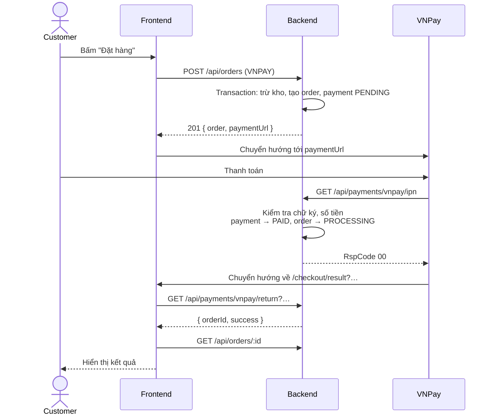

# 05 – API Documentation

Đây là **API contract** giữa frontend và backend. Mọi thay đổi phải được cập nhật vào tài liệu này trong cùng Pull Request. Khi code đã chạy, Swagger tự sinh tại `/api/docs` là nguồn tham chiếu chi tiết từng field.

## 1. Quy ước chung

### 1.1 Cơ bản

| Hạng mục | Quy ước |
|----------|---------|
| Base URL | `http://localhost:4000/api` (development) |
| Định dạng | JSON, UTF-8; field dùng `camelCase` |
| Xác thực | Header `Authorization: Bearer <accessToken>` |
| Thời gian | ISO 8601 UTC, ví dụ `2026-11-10T08:30:00.000Z` |
| Tiền | Số nguyên, đơn vị VND |
| ID | UUID dạng chuỗi |
| Tài nguyên | Danh từ số nhiều, `kebab-case` |

### 1.2 Phân vùng URL

URL thể hiện góc nhìn của người gọi, giúp phân quyền rõ ràng và tránh trùng lặp endpoint:

| Tiền tố | Ai gọi | Ví dụ |
|---------|--------|-------|
| `/api/...` | Công khai hoặc Customer | `/api/products`, `/api/cart`, `/api/orders` |
| `/api/seller/...` | Seller, chỉ thấy dữ liệu của store mình | `/api/seller/products`, `/api/seller/orders` |
| `/api/admin/...` | Admin | `/api/admin/users` |

### 1.3 Ký hiệu cột Auth

| Ký hiệu | Ý nghĩa |
|---------|---------|
| Public | Không cần token |
| User | Đã đăng nhập, role bất kỳ |
| Customer | Role CUSTOMER |
| Seller | Role SELLER và hồ sơ seller ở trạng thái APPROVED |
| Admin | Role ADMIN |

### 1.4 Response thành công

```json
{
  "success": true,
  "data": { }
}
```

Danh sách có phân trang:

```json
{
  "success": true,
  "data": [ ],
  "meta": { "page": 1, "limit": 20, "total": 135, "totalPages": 7 }
}
```

Tham số phân trang chung: `page` (mặc định 1), `limit` (mặc định 20, tối đa 100).

### 1.5 Response lỗi

```json
{
  "success": false,
  "error": {
    "code": "INSUFFICIENT_STOCK",
    "message": "Sản phẩm không đủ số lượng trong kho",
    "details": [ { "variantId": "…", "requested": 3, "available": 1 } ]
  }
}
```

- `code`: hằng số để frontend xử lý theo logic.
- `message`: tiếng Việt, hiển thị được cho người dùng.
- `details`: tùy chọn; với lỗi validate là danh sách `{ field, message }`.

### 1.6 HTTP status codes

| Code | Khi nào dùng |
|------|--------------|
| 200 | GET, PATCH, PUT thành công; POST là hành động không tạo tài nguyên |
| 201 | POST tạo tài nguyên thành công |
| 204 | DELETE thành công, không có body |
| 400 | Dữ liệu sai định dạng hoặc vi phạm quy tắc đơn giản |
| 401 | Thiếu token, token sai hoặc hết hạn |
| 403 | Đã đăng nhập nhưng không có quyền |
| 404 | Không tìm thấy tài nguyên, hoặc tài nguyên không thuộc về người gọi |
| 409 | Xung đột với trạng thái hiện tại (trùng, hết hàng, chuyển trạng thái sai) |
| 422 | Không dùng; lỗi validate trả 400 |
| 429 | Vượt rate limit |
| 500 | Lỗi không lường trước |

Lỗi chung áp dụng cho mọi endpoint, không lặp lại trong các bảng bên dưới:

| HTTP | code | Trường hợp |
|------|------|------------|
| 400 | `VALIDATION_ERROR` | Body, query hoặc param không hợp lệ |
| 401 | `UNAUTHORIZED` | Endpoint cần đăng nhập nhưng thiếu token hoặc token không hợp lệ |
| 403 | `FORBIDDEN` | Sai role |
| 403 | `SELLER_NOT_APPROVED` | Gọi `/api/seller/*` khi seller chưa APPROVED |
| 429 | `TOO_MANY_REQUESTS` | Vượt rate limit |
| 500 | `INTERNAL_ERROR` | Lỗi server |

Khi tài nguyên tồn tại nhưng thuộc về người khác, API trả **404** thay vì 403 để không tiết lộ sự tồn tại của nó.

## 2. Health

| Method | URL | Mục đích | Auth | Response |
|--------|-----|----------|------|----------|
| GET | `/api/health` | Kiểm tra server và kết nối DB | Public | 200 `{ status: "ok", db: "up" }` |

## 3. Authentication

| Method | URL | Mục đích | Auth | Request body | Thành công | Lỗi riêng |
|--------|-----|----------|------|--------------|------------|-----------|
| POST | `/api/auth/register` | Đăng ký tài khoản Customer | Public | `email`, `password`, `fullName` | 201 `{ user, accessToken }` + cookie refresh | 409 `EMAIL_ALREADY_EXISTS` |
| POST | `/api/auth/login` | Đăng nhập | Public | `email`, `password` | 200 `{ user, accessToken }` + cookie refresh | 401 `INVALID_CREDENTIALS`; 403 `ACCOUNT_BANNED` |
| POST | `/api/auth/refresh` | Lấy access token mới, xoay refresh token | Cookie `refreshToken` | – | 200 `{ accessToken }` + cookie mới | 401 `INVALID_REFRESH_TOKEN` |
| POST | `/api/auth/logout` | Thu hồi refresh token, xóa cookie | User | – | 204 | – |
| GET | `/api/auth/me` | Thông tin người đang đăng nhập | User | – | 200 `{ user }` | – |

Đối tượng `user`:

```json
{
  "id": "0b8f…",
  "email": "an@example.com",
  "fullName": "Nguyễn Văn An",
  "phone": null,
  "avatarUrl": null,
  "roles": ["CUSTOMER"],
  "sellerStatus": null
}
```

Ví dụ đăng nhập:

```http
POST /api/auth/login
Content-Type: application/json

{ "email": "an@example.com", "password": "matkhau123" }
```

```http
HTTP/1.1 200 OK
Set-Cookie: refreshToken=…; HttpOnly; Path=/api/auth; SameSite=Lax; Max-Age=604800

{ "success": true, "data": { "user": { … }, "accessToken": "eyJhbGciOi…" } }
```

Validation: `email` đúng định dạng, tự chuyển chữ thường; `password` 8–72 ký tự, có ít nhất một chữ và một số; `fullName` 2–100 ký tự. Thông báo lỗi đăng nhập không phân biệt "sai email" và "sai mật khẩu".

## 4. User Management

| Method | URL | Mục đích | Auth | Request body | Thành công | Lỗi riêng |
|--------|-----|----------|------|--------------|------------|-----------|
| GET | `/api/users/me` | Xem hồ sơ | User | – | 200 `user` | – |
| PATCH | `/api/users/me` | Sửa hồ sơ | User | `fullName?`, `phone?` | 200 `user` | – |
| PATCH | `/api/users/me/password` | Đổi mật khẩu | User | `currentPassword`, `newPassword` | 204; thu hồi mọi refresh token khác | 400 `WRONG_PASSWORD` |
| GET | `/api/users/me/addresses` | Danh sách địa chỉ | User | – | 200 `Address[]` | – |
| POST | `/api/users/me/addresses` | Thêm địa chỉ | User | `recipientName`, `phone`, `province`, `district`, `ward`, `street`, `isDefault?` | 201 `Address` | 400 `ADDRESS_LIMIT_REACHED` |
| PATCH | `/api/users/me/addresses/:id` | Sửa địa chỉ | User | Các field như trên, đều tùy chọn | 200 `Address` | 404 `ADDRESS_NOT_FOUND` |
| DELETE | `/api/users/me/addresses/:id` | Xóa địa chỉ | User | – | 204 | 404 `ADDRESS_NOT_FOUND` |

Validation: `phone` là số điện thoại Việt Nam (10 chữ số, bắt đầu bằng 0).

## 5. Seller Management

### 5.1 Đăng ký và hồ sơ

| Method | URL | Mục đích | Auth | Request body | Thành công | Lỗi riêng |
|--------|-----|----------|------|--------------|------------|-----------|
| POST | `/api/sellers/register` | Gửi hồ sơ bán hàng | Customer | `businessName`, `phone`, `taxCode?`, `storeName`, `storeDescription?` | 201 `{ seller, store }`, trạng thái PENDING | 409 `SELLER_ALREADY_REGISTERED` |
| GET | `/api/sellers/me` | Xem hồ sơ và trạng thái duyệt | User | – | 200 `{ seller, store }` | 404 `SELLER_NOT_FOUND` |
| PATCH | `/api/sellers/me` | Sửa hồ sơ; nếu đang REJECTED thì chuyển về PENDING | User | Các field như đăng ký, tùy chọn | 200 `{ seller, store }` | 409 `INVALID_SELLER_STATUS` (đang SUSPENDED) |

### 5.2 Store

| Method | URL | Mục đích | Auth | Request | Thành công | Lỗi riêng |
|--------|-----|----------|------|---------|------------|-----------|
| GET | `/api/stores/:slug` | Trang store công khai | Public | – | 200 `Store` kèm `productCount` | 404 `STORE_NOT_FOUND` |
| PATCH | `/api/seller/store` | Sửa tên, mô tả | Seller | `name?`, `description?` | 200 `Store` | – |
| POST | `/api/seller/store/logo` | Upload logo | Seller | `multipart/form-data`, field `file` | 200 `{ logoUrl }` | 400 `INVALID_FILE` |

Sản phẩm của store lấy qua `GET /api/products?storeSlug=…`.

### 5.3 Thống kê của Seller

| Method | URL | Mục đích | Auth | Query | Thành công |
|--------|-----|----------|------|-------|------------|
| GET | `/api/seller/stats/overview` | Tổng quan doanh thu | Seller | `from?`, `to?` (ngày, mặc định 30 ngày gần nhất) | 200 `{ revenue, orderCount, pendingOrderCount, productCount, lowStockCount }` |
| GET | `/api/seller/stats/revenue` | Doanh thu theo ngày | Seller | `from`, `to` (tối đa 90 ngày) | 200 `[{ date, revenue, orderCount }]` |
| GET | `/api/seller/stats/top-products` | Sản phẩm bán chạy | Seller | `from?`, `to?`, `limit?` (mặc định 5) | 200 `[{ productId, name, quantitySold, revenue }]` |

Doanh thu chỉ tính seller order ở trạng thái COMPLETED.

## 6. Category Management

| Method | URL | Mục đích | Auth | Request body | Thành công | Lỗi riêng |
|--------|-----|----------|------|--------------|------------|-----------|
| GET | `/api/categories` | Cây danh mục đang bật | Public | – | 200 `Category[]` (mỗi phần tử có `children`) | – |
| GET | `/api/categories/:slug` | Chi tiết một danh mục | Public | – | 200 `Category` | 404 `CATEGORY_NOT_FOUND` |
| GET | `/api/admin/categories` | Toàn bộ danh mục, kể cả đang tắt | Admin | – | 200 `Category[]` | – |
| POST | `/api/admin/categories` | Tạo danh mục | Admin | `name`, `parentId?`, `sortOrder?` | 201 `Category` | 400 `CATEGORY_DEPTH_EXCEEDED`; 404 `CATEGORY_NOT_FOUND` (parent) |
| PATCH | `/api/admin/categories/:id` | Sửa, bật/tắt | Admin | `name?`, `sortOrder?`, `isActive?` | 200 `Category` | 404 `CATEGORY_NOT_FOUND` |
| DELETE | `/api/admin/categories/:id` | Xóa danh mục | Admin | – | 204 | 409 `CATEGORY_HAS_CHILDREN`, `CATEGORY_HAS_PRODUCTS` |

## 7. Product Management và Search

### 7.1 Công khai

| Method | URL | Mục đích | Auth | Thành công | Lỗi riêng |
|--------|-----|----------|------|------------|-----------|
| GET | `/api/products` | Tìm kiếm, lọc, liệt kê sản phẩm | Public | 200 `ProductSummary[]` + `meta` | – |
| GET | `/api/products/:slug` | Chi tiết sản phẩm | Public | 200 `ProductDetail` | 404 `PRODUCT_NOT_FOUND` |

Query của `GET /api/products`:

| Tham số | Kiểu | Mô tả |
|---------|------|-------|
| `q` | string, ≤ 100 ký tự | Từ khóa tìm trên tên, không phân biệt hoa thường và dấu |
| `categorySlug` | string | Lọc theo danh mục, bao gồm danh mục con |
| `storeSlug` | string | Lọc theo store |
| `minPrice`, `maxPrice` | int ≥ 0 | Khoảng giá, so với `minPrice` của sản phẩm |
| `minRating` | 1–5 | Rating trung bình tối thiểu |
| `inStock` | boolean | Chỉ lấy sản phẩm còn hàng |
| `sort` | enum | `newest` (mặc định), `price_asc`, `price_desc`, `best_selling`, `rating` |
| `page`, `limit` | int | Phân trang |

`ProductSummary`:

```json
{
  "id": "…", "name": "Áo thun cotton", "slug": "ao-thun-cotton-x8k2",
  "thumbnailUrl": "https://res.cloudinary.com/…",
  "minPrice": 150000, "ratingAvg": 4.6, "ratingCount": 23, "soldCount": 120,
  "store": { "name": "Shop An", "slug": "shop-an" }
}
```

`ProductDetail` gồm các field trên và thêm:

```json
{
  "description": "…",
  "category": { "id": "…", "name": "Áo nam", "slug": "ao-nam" },
  "images": [ { "id": "…", "url": "…", "sortOrder": 0 } ],
  "variants": [
    { "id": "…", "sku": "AT-DO-L", "name": "Đỏ / L",
      "attributes": { "Màu": "Đỏ", "Size": "L" }, "price": 150000, "stock": 12 }
  ]
}
```

### 7.2 Seller

| Method | URL | Mục đích | Auth | Request body | Thành công | Lỗi riêng |
|--------|-----|----------|------|--------------|------------|-----------|
| GET | `/api/seller/products` | Sản phẩm của store, mọi trạng thái | Seller | Query: `q?`, `status?`, `page`, `limit` | 200 danh sách + `meta` | – |
| GET | `/api/seller/products/:id` | Chi tiết để chỉnh sửa | Seller | – | 200 `ProductDetail` kèm `status` | 404 `PRODUCT_NOT_FOUND` |
| POST | `/api/seller/products` | Tạo sản phẩm (DRAFT) | Seller | `name`, `description`, `categoryId`, `variants[]` (mỗi phần tử: `sku`, `name`, `attributes?`, `price`, `stock`) | 201 `ProductDetail` | 400 `CATEGORY_NOT_LEAF`; 404 `CATEGORY_NOT_FOUND`; 409 `DUPLICATE_SKU` |
| PATCH | `/api/seller/products/:id` | Sửa thông tin chung | Seller | `name?`, `description?`, `categoryId?` | 200 `ProductDetail` | 404 `PRODUCT_NOT_FOUND`; 403 `PRODUCT_BANNED` |
| PATCH | `/api/seller/products/:id/status` | Đổi trạng thái | Seller | `status`: `DRAFT`, `ACTIVE` hoặc `HIDDEN` | 200 `{ id, status }` | 400 `PRODUCT_NOT_PUBLISHABLE`; 403 `PRODUCT_BANNED` |
| DELETE | `/api/seller/products/:id` | Xóa mềm | Seller | – | 204 | 404 `PRODUCT_NOT_FOUND` |
| POST | `/api/seller/products/:id/variants` | Thêm variant | Seller | `sku`, `name`, `attributes?`, `price`, `stock` | 201 `Variant` | 409 `DUPLICATE_SKU` |
| PATCH | `/api/seller/products/:id/variants/:variantId` | Sửa variant (giá, tên, bật/tắt) | Seller | `sku?`, `name?`, `attributes?`, `price?`, `isActive?` | 200 `Variant` | 404 `VARIANT_NOT_FOUND`; 409 `DUPLICATE_SKU`; 400 `LAST_ACTIVE_VARIANT` |
| DELETE | `/api/seller/products/:id/variants/:variantId` | Xóa variant chưa từng được bán | Seller | – | 204 | 409 `VARIANT_HAS_ORDERS`; 400 `LAST_ACTIVE_VARIANT` |
| POST | `/api/seller/products/:id/images` | Upload ảnh | Seller | `multipart/form-data`, field `files` (tối đa 8 ảnh/sản phẩm) | 201 `Image[]` | 400 `INVALID_FILE`, `IMAGE_LIMIT_REACHED` |
| PATCH | `/api/seller/products/:id/images/order` | Sắp xếp ảnh; ảnh đầu là ảnh đại diện | Seller | `imageIds[]` | 200 `Image[]` | 400 `VALIDATION_ERROR` |
| DELETE | `/api/seller/products/:id/images/:imageId` | Xóa ảnh | Seller | – | 204 | 404 `IMAGE_NOT_FOUND` |

Validation: `name` 5–200 ký tự; `description` ≤ 10.000 ký tự; `price` nguyên, 1.000–500.000.000; `stock` nguyên, 0–1.000.000; `sku` 1–50 ký tự gồm chữ, số, gạch ngang; mỗi sản phẩm tối đa 30 variant; ảnh JPEG/PNG/WebP, ≤ 5MB.

## 8. Inventory Management

| Method | URL | Mục đích | Auth | Request | Thành công | Lỗi riêng |
|--------|-----|----------|------|---------|------------|-----------|
| GET | `/api/seller/inventory` | Tồn kho mọi variant của store | Seller | Query: `q?`, `lowStock?` (boolean), `page`, `limit` | 200 `[{ variantId, productId, productName, variantName, sku, quantity, lowStockThreshold }]` + `meta` | – |
| PATCH | `/api/seller/inventory/:variantId` | Cập nhật tồn kho | Seller | `quantity?` (đặt giá trị mới, ≥ 0), `lowStockThreshold?` | 200 bản ghi tồn kho | 404 `VARIANT_NOT_FOUND` |

Tồn kho công khai được trả qua field `stock` trong `ProductDetail.variants`. Việc trừ và hoàn kho theo đơn hàng là nội bộ, không có endpoint.

## 9. Shopping Cart

| Method | URL | Mục đích | Auth | Request body | Thành công | Lỗi riêng |
|--------|-----|----------|------|--------------|------------|-----------|
| GET | `/api/cart` | Xem giỏ hàng | Customer | – | 200 `Cart` | – |
| POST | `/api/cart/items` | Thêm vào giỏ, cộng dồn nếu đã có | Customer | `variantId`, `quantity` (≥ 1) | 201 `Cart` | 400 `VARIANT_NOT_AVAILABLE`, `CANNOT_BUY_OWN_PRODUCT`, `CART_LIMIT_REACHED`; 409 `INSUFFICIENT_STOCK` |
| PATCH | `/api/cart/items/:id` | Đổi số lượng | Customer | `quantity` (≥ 1) | 200 `Cart` | 404 `CART_ITEM_NOT_FOUND`; 409 `INSUFFICIENT_STOCK` |
| DELETE | `/api/cart/items/:id` | Xóa một item | Customer | – | 200 `Cart` | 404 `CART_ITEM_NOT_FOUND` |
| DELETE | `/api/cart` | Xóa toàn bộ giỏ | Customer | – | 204 | – |

`Cart`:

```json
{
  "itemCount": 3,
  "subtotal": 830000,
  "groups": [
    {
      "store": { "id": "…", "name": "Shop An", "slug": "shop-an" },
      "items": [
        {
          "id": "…", "variantId": "…", "productId": "…",
          "productName": "Áo thun cotton", "productSlug": "ao-thun-cotton-x8k2",
          "variantName": "Đỏ / L", "imageUrl": "…",
          "unitPrice": 150000, "quantity": 2, "lineTotal": 300000,
          "stock": 12, "available": true
        }
      ]
    }
  ]
}
```

`available = false` khi sản phẩm không còn ACTIVE, variant bị tắt hoặc hết hàng. `subtotal` chỉ tính item `available`.

## 10. Order Management

### 10.1 Customer

| Method | URL | Mục đích | Auth | Request | Thành công | Lỗi riêng |
|--------|-----|----------|------|---------|------------|-----------|
| POST | `/api/orders/preview` | Tính tiền trước khi đặt, không tạo đơn | Customer | `cartItemIds[]` | 200 `{ groups, subtotal, shippingFee, total }` | 400 `CART_EMPTY`, `ITEMS_NOT_AVAILABLE` |
| POST | `/api/orders` | Tạo đơn hàng (checkout) | Customer | `cartItemIds[]`, `addressId`, `paymentMethod` (`COD` hoặc `VNPAY`), `note?` | 201 `{ order, paymentUrl }` | 400 `CART_EMPTY`, `ITEMS_NOT_AVAILABLE`, `ORDER_TOTAL_EXCEEDED`; 404 `ADDRESS_NOT_FOUND`; 409 `INSUFFICIENT_STOCK` |
| GET | `/api/orders` | Lịch sử đơn | Customer | Query: `status?`, `page`, `limit` | 200 `OrderSummary[]` + `meta` | – |
| GET | `/api/orders/:id` | Chi tiết đơn | Customer | – | 200 `Order` | 404 `ORDER_NOT_FOUND` |
| POST | `/api/orders/:id/cancel` | Hủy toàn bộ đơn khi mọi seller order còn PENDING | Customer | `reason?` | 200 `Order` | 404 `ORDER_NOT_FOUND`; 409 `INVALID_STATUS_TRANSITION` |
| POST | `/api/orders/:id/seller-orders/:sellerOrderId/cancel` | Hủy một phần đơn còn PENDING | Customer | `reason?` | 200 `Order` | 404 `ORDER_NOT_FOUND`; 409 `INVALID_STATUS_TRANSITION` |
| POST | `/api/orders/:id/seller-orders/:sellerOrderId/confirm-received` | Xác nhận đã nhận hàng (DELIVERED → COMPLETED) | Customer | – | 200 `Order` | 404 `ORDER_NOT_FOUND`; 409 `INVALID_STATUS_TRANSITION` |

`paymentUrl` là `null` với COD; với VNPAY là URL để frontend chuyển hướng.

Ví dụ checkout:

```http
POST /api/orders
Authorization: Bearer …

{
  "cartItemIds": ["c1…", "c2…"],
  "addressId": "a1…",
  "paymentMethod": "VNPAY",
  "note": "Giao giờ hành chính"
}
```

```json
{
  "success": true,
  "data": {
    "paymentUrl": "https://sandbox.vnpayment.vn/paymentv2/vpcpay.html?…",
    "order": {
      "id": "…", "code": "ORD-20261110-K3P9ZQ",
      "status": "PENDING_PAYMENT", "paymentMethod": "VNPAY",
      "shipping": { "name": "Trần Thị C", "phone": "0901234567",
                    "address": "12 Tạ Quang Bửu, Bách Khoa, Hai Bà Trưng, Hà Nội" },
      "subtotal": 800000, "shippingFee": 60000, "total": 860000,
      "note": "Giao giờ hành chính",
      "payment": { "id": "…", "status": "PENDING", "expiresAt": "2026-11-10T08:45:00.000Z" },
      "sellerOrders": [
        {
          "id": "…", "code": "ORD-20261110-K3P9ZQ-1", "status": "PENDING",
          "store": { "id": "…", "name": "Shop An", "slug": "shop-an" },
          "subtotal": 300000, "shippingFee": 30000, "total": 330000,
          "items": [
            { "id": "…", "productId": "…", "productName": "Áo thun cotton",
              "variantName": "Đỏ / L", "imageUrl": "…",
              "unitPrice": 150000, "quantity": 2, "lineTotal": 300000,
              "reviewed": false }
          ]
        }
      ],
      "createdAt": "2026-11-10T08:30:00.000Z"
    }
  }
}
```

Lỗi `INSUFFICIENT_STOCK` trả `details` liệt kê từng variant thiếu hàng để frontend chỉ ra cho khách.

### 10.2 Seller

| Method | URL | Mục đích | Auth | Request | Thành công | Lỗi riêng |
|--------|-----|----------|------|---------|------------|-----------|
| GET | `/api/seller/orders` | Đơn của store; không gồm đơn đang chờ thanh toán online | Seller | Query: `status?`, `q?` (mã đơn), `page`, `limit` | 200 `SellerOrder[]` + `meta` | – |
| GET | `/api/seller/orders/:id` | Chi tiết, kèm thông tin giao hàng | Seller | – | 200 `SellerOrder` | 404 `ORDER_NOT_FOUND` |
| PATCH | `/api/seller/orders/:id/status` | Chuyển trạng thái | Seller | `status`: `CONFIRMED`, `SHIPPING`, `DELIVERED` hoặc `CANCELLED`; `reason` bắt buộc khi hủy | 200 `SellerOrder` | 404 `ORDER_NOT_FOUND`; 409 `INVALID_STATUS_TRANSITION`, `ORDER_NOT_PAID` |

`:id` ở đây là id của **seller order**. Seller không bao giờ thấy phần đơn của store khác hay tổng tiền của cả đơn.

## 11. Payment

| Method | URL | Mục đích | Auth | Request | Thành công | Lỗi riêng |
|--------|-----|----------|------|---------|------------|-----------|
| GET | `/api/payments/order/:orderId` | Trạng thái thanh toán hiện tại của đơn | Customer | – | 200 `Payment` | 404 `ORDER_NOT_FOUND` |
| POST | `/api/payments/order/:orderId/retry` | Tạo lần thanh toán mới cho đơn còn hạn | Customer | – | 201 `{ payment, paymentUrl }` | 404 `ORDER_NOT_FOUND`; 409 `ORDER_ALREADY_PAID`, `PAYMENT_EXPIRED`, `PAYMENT_METHOD_NOT_ONLINE` |
| GET | `/api/payments/vnpay/ipn` | VNPay gọi để báo kết quả (server-to-server) | Public, xác thực bằng chữ ký | Query do VNPay gửi | 200 `{ RspCode, Message }` theo định dạng của VNPay | Mã lỗi trả trong `RspCode` |
| GET | `/api/payments/vnpay/return` | Kiểm tra chữ ký tham số trên URL return để frontend hiển thị kết quả | Public | Query do VNPay gửi | 200 `{ orderId, orderCode, success }` | 400 `INVALID_SIGNATURE` |

Luồng thanh toán online:



Endpoint `return` **không** thay đổi trạng thái đơn; chỉ IPN mới được thay đổi. Lý do: URL return đi qua trình duyệt nên khách có thể không quay lại, hoặc cố tình sửa tham số. Frontend sau khi về trang kết quả nên gọi lại `GET /api/orders/:id` vài lần (cách nhau 2 giây) nếu trạng thái vẫn là PENDING_PAYMENT, vì IPN có thể đến chậm hơn.

Các endpoint này không nhận bất kỳ dữ liệu thẻ nào; khách nhập thông tin thẻ trực tiếp trên trang của VNPay.

## 12. Review và Rating

| Method | URL | Mục đích | Auth | Request | Thành công | Lỗi riêng |
|--------|-----|----------|------|---------|------------|-----------|
| GET | `/api/products/:productId/reviews` | Review của sản phẩm | Public | Query: `rating?` (1–5), `page`, `limit` | 200 `Review[]` + `meta`; `meta.summary` gồm `ratingAvg`, `ratingCount`, `distribution` | 404 `PRODUCT_NOT_FOUND` |
| POST | `/api/reviews` | Viết review cho một order item | Customer | `orderItemId`, `rating` (1–5), `comment?` (≤ 1000 ký tự) | 201 `Review` | 403 `REVIEW_NOT_ALLOWED`; 404 `ORDER_ITEM_NOT_FOUND`; 409 `REVIEW_ALREADY_EXISTS` |
| PATCH | `/api/reviews/:id` | Sửa review của mình trong 7 ngày | Customer | `rating?`, `comment?` | 200 `Review` | 403 `REVIEW_EDIT_EXPIRED`; 404 `REVIEW_NOT_FOUND` |
| GET | `/api/reviews/me` | Review tôi đã viết | Customer | Query: `page`, `limit` | 200 `Review[]` + `meta` | – |

`Review`:

```json
{
  "id": "…", "rating": 5, "comment": "Vải đẹp, giao nhanh",
  "user": { "fullName": "Trần T** C", "avatarUrl": null },
  "variantName": "Đỏ / L",
  "createdAt": "2026-11-15T03:00:00.000Z"
}
```

Tên người đánh giá được che bớt khi hiển thị công khai.

## 13. Notification

| Method | URL | Mục đích | Auth | Request | Thành công | Lỗi riêng |
|--------|-----|----------|------|---------|------------|-----------|
| GET | `/api/notifications` | Danh sách thông báo | User | Query: `isRead?`, `page`, `limit` | 200 `Notification[]` + `meta` | – |
| GET | `/api/notifications/unread-count` | Số thông báo chưa đọc | User | – | 200 `{ count }` | – |
| PATCH | `/api/notifications/:id/read` | Đánh dấu đã đọc | User | – | 200 `Notification` | 404 `NOTIFICATION_NOT_FOUND` |
| PATCH | `/api/notifications/read-all` | Đánh dấu tất cả đã đọc | User | – | 200 `{ updated }` | – |

Giá trị `type`: `SELLER_APPROVED`, `SELLER_REJECTED`, `ORDER_NEW`, `ORDER_STATUS_CHANGED`, `PAYMENT_SUCCEEDED`, `PAYMENT_FAILED`.

## 14. Admin

Mọi endpoint trong mục này yêu cầu role ADMIN. Danh mục xem ở mục 6.

### 14.1 Người dùng

| Method | URL | Mục đích | Request | Thành công | Lỗi riêng |
|--------|-----|----------|---------|------------|-----------|
| GET | `/api/admin/users` | Danh sách người dùng | Query: `q?` (email, tên), `role?`, `status?`, `page`, `limit` | 200 `User[]` + `meta` | – |
| GET | `/api/admin/users/:id` | Chi tiết | – | 200 `User` kèm `orderCount`, `seller` | 404 `USER_NOT_FOUND` |
| PATCH | `/api/admin/users/:id/status` | Khóa hoặc mở khóa; khi khóa thì thu hồi mọi refresh token | `status`: `ACTIVE` hoặc `BANNED` | 200 `User` | 400 `CANNOT_BAN_SELF`; 404 `USER_NOT_FOUND` |

### 14.2 Người bán

| Method | URL | Mục đích | Request | Thành công | Lỗi riêng |
|--------|-----|----------|---------|------------|-----------|
| GET | `/api/admin/sellers` | Danh sách hồ sơ seller | Query: `status?`, `q?`, `page`, `limit` | 200 danh sách + `meta` | – |
| GET | `/api/admin/sellers/:id` | Chi tiết hồ sơ | – | 200 `{ seller, store, user }` | 404 `SELLER_NOT_FOUND` |
| PATCH | `/api/admin/sellers/:id/status` | Duyệt, từ chối, tạm ngưng, mở lại | `status`: `APPROVED`, `REJECTED` hoặc `SUSPENDED`; `reason` bắt buộc khi từ chối hoặc tạm ngưng | 200 `seller` | 404 `SELLER_NOT_FOUND`; 409 `INVALID_SELLER_STATUS` |

Chuyển trạng thái seller hợp lệ: PENDING → APPROVED hoặc REJECTED; APPROVED → SUSPENDED; SUSPENDED → APPROVED.

### 14.3 Sản phẩm và review

| Method | URL | Mục đích | Request | Thành công | Lỗi riêng |
|--------|-----|----------|---------|------------|-----------|
| GET | `/api/admin/products` | Mọi sản phẩm, mọi trạng thái | Query: `q?`, `status?`, `storeId?`, `categoryId?`, `page`, `limit` | 200 danh sách + `meta` | – |
| PATCH | `/api/admin/products/:id/status` | Cấm hoặc gỡ cấm | `status`: `BANNED` hoặc `HIDDEN`; `reason?` | 200 `{ id, status }` | 404 `PRODUCT_NOT_FOUND` |
| GET | `/api/admin/reviews` | Danh sách review để kiểm duyệt | Query: `productId?`, `isHidden?`, `page`, `limit` | 200 danh sách + `meta` | – |
| PATCH | `/api/admin/reviews/:id/visibility` | Ẩn hoặc hiện review; rating sản phẩm được tính lại | `isHidden` | 200 `Review` | 404 `REVIEW_NOT_FOUND` |

Gỡ cấm đưa sản phẩm về HIDDEN để Seller tự bật lại.

### 14.4 Đơn hàng và thanh toán

| Method | URL | Mục đích | Request | Thành công | Lỗi riêng |
|--------|-----|----------|---------|------------|-----------|
| GET | `/api/admin/orders` | Mọi đơn hàng | Query: `status?`, `q?` (mã đơn, email), `from?`, `to?`, `page`, `limit` | 200 danh sách + `meta` | – |
| GET | `/api/admin/orders/:id` | Chi tiết đơn, gồm mọi seller order và payment | – | 200 `Order` | 404 `ORDER_NOT_FOUND` |
| POST | `/api/admin/seller-orders/:id/cancel` | Hủy một seller order (PENDING hoặc CONFIRMED) | `reason` | 200 `SellerOrder` | 404 `ORDER_NOT_FOUND`; 409 `INVALID_STATUS_TRANSITION` |
| POST | `/api/admin/seller-orders/:id/complete` | Hoàn tất thay khách (DELIVERED → COMPLETED) | – | 200 `SellerOrder` | 409 `INVALID_STATUS_TRANSITION` |
| GET | `/api/admin/payments` | Danh sách thanh toán | Query: `status?`, `page`, `limit` | 200 danh sách + `meta` | – |
| PATCH | `/api/admin/payments/:id/refund` | Xác nhận đã hoàn tiền thủ công (REFUND_PENDING → REFUNDED) | `note?` | 200 `Payment` | 404 `PAYMENT_NOT_FOUND`; 409 `INVALID_STATUS_TRANSITION` |

### 14.5 Thống kê

| Method | URL | Mục đích | Query | Thành công |
|--------|-----|----------|-------|------------|
| GET | `/api/admin/stats/overview` | Số liệu tổng quan | – | 200 `{ userCount, sellerCount, pendingSellerCount, productCount, orderCount, revenue }` |
| GET | `/api/admin/stats/revenue` | Doanh thu toàn sàn theo ngày | `from`, `to` (tối đa 90 ngày) | 200 `[{ date, revenue, orderCount }]` |
| GET | `/api/admin/stats/top-stores` | Store doanh thu cao nhất | `from?`, `to?`, `limit?` | 200 `[{ storeId, name, revenue, orderCount }]` |

## 15. Tổng hợp mã lỗi theo module

| Module | Mã lỗi |
|--------|--------|
| Chung | `VALIDATION_ERROR`, `UNAUTHORIZED`, `FORBIDDEN`, `TOO_MANY_REQUESTS`, `INTERNAL_ERROR` |
| Auth | `EMAIL_ALREADY_EXISTS`, `INVALID_CREDENTIALS`, `ACCOUNT_BANNED`, `INVALID_REFRESH_TOKEN` |
| User | `USER_NOT_FOUND`, `WRONG_PASSWORD`, `ADDRESS_NOT_FOUND`, `ADDRESS_LIMIT_REACHED`, `CANNOT_BAN_SELF` |
| Seller | `SELLER_NOT_FOUND`, `SELLER_ALREADY_REGISTERED`, `SELLER_NOT_APPROVED`, `INVALID_SELLER_STATUS`, `STORE_NOT_FOUND` |
| Category | `CATEGORY_NOT_FOUND`, `CATEGORY_NOT_LEAF`, `CATEGORY_HAS_CHILDREN`, `CATEGORY_HAS_PRODUCTS`, `CATEGORY_DEPTH_EXCEEDED` |
| Product | `PRODUCT_NOT_FOUND`, `PRODUCT_BANNED`, `PRODUCT_NOT_PUBLISHABLE`, `VARIANT_NOT_FOUND`, `DUPLICATE_SKU`, `LAST_ACTIVE_VARIANT`, `VARIANT_HAS_ORDERS`, `IMAGE_NOT_FOUND`, `IMAGE_LIMIT_REACHED`, `INVALID_FILE` |
| Cart | `CART_ITEM_NOT_FOUND`, `VARIANT_NOT_AVAILABLE`, `CANNOT_BUY_OWN_PRODUCT`, `CART_LIMIT_REACHED` |
| Inventory | `INSUFFICIENT_STOCK` |
| Order | `ORDER_NOT_FOUND`, `ORDER_ITEM_NOT_FOUND`, `CART_EMPTY`, `ITEMS_NOT_AVAILABLE`, `ORDER_TOTAL_EXCEEDED`, `INVALID_STATUS_TRANSITION`, `ORDER_NOT_PAID` |
| Payment | `PAYMENT_NOT_FOUND`, `PAYMENT_EXPIRED`, `ORDER_ALREADY_PAID`, `PAYMENT_METHOD_NOT_ONLINE`, `INVALID_SIGNATURE` |
| Review | `REVIEW_NOT_FOUND`, `REVIEW_NOT_ALLOWED`, `REVIEW_ALREADY_EXISTS`, `REVIEW_EDIT_EXPIRED` |
| Notification | `NOTIFICATION_NOT_FOUND` |

Các mã lỗi được định nghĩa một lần trong `apps/api/src/common/errors/error-codes.ts`; frontend dùng chung danh sách này.
