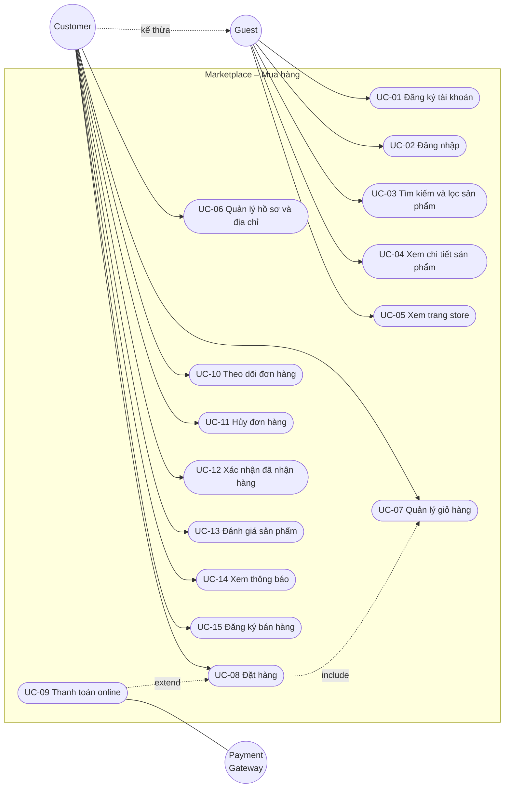
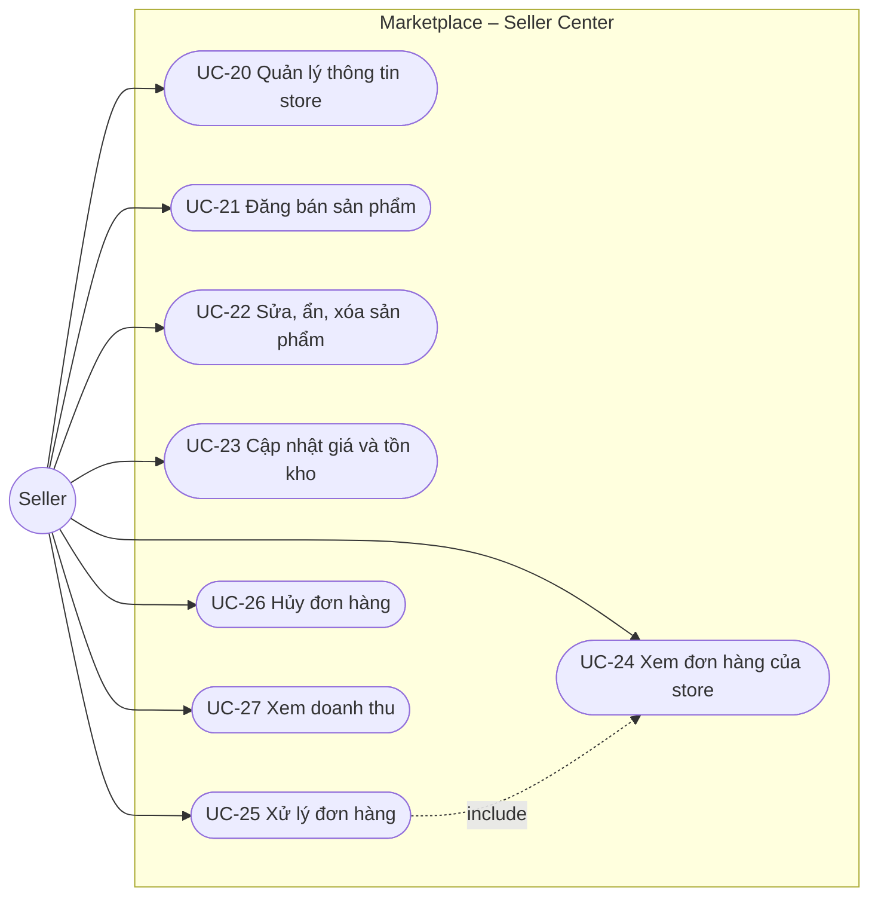
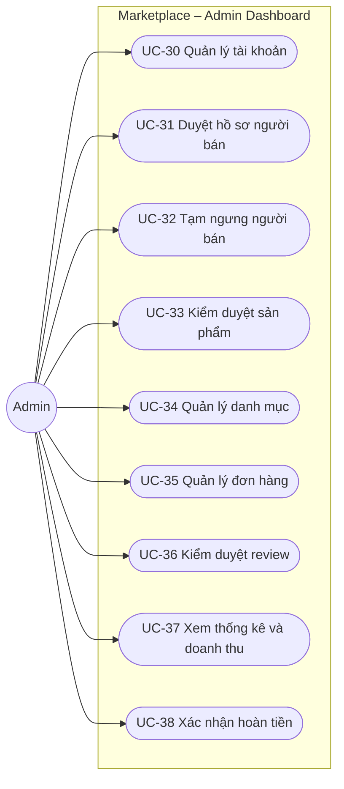
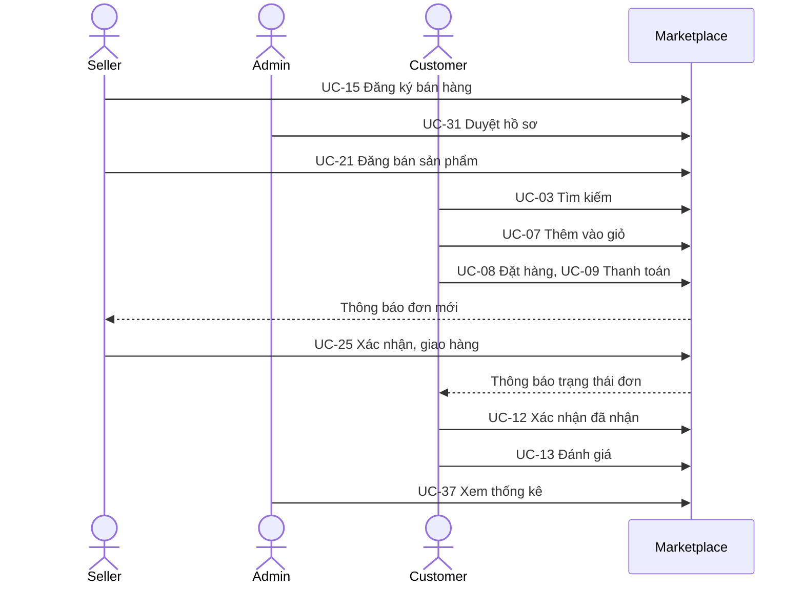

# 06 – Use Cases

## 1. Tác nhân

| Tác nhân | Mô tả |
|----------|-------|
| Guest | Người truy cập chưa đăng nhập |
| Customer | Người dùng đã đăng nhập; kế thừa mọi use case của Guest |
| Seller | Người dùng đã được duyệt bán hàng; kế thừa mọi use case của Customer |
| Admin | Quản trị viên hệ thống |
| Payment Gateway | VNPay, tác nhân hệ thống bên ngoài |

## 2. Use Case Diagram

Mermaid không có loại biểu đồ use case riêng nên dùng flowchart: hình tròn là tác nhân, hình bo tròn là use case.

### 2.1 Guest và Customer

### 2.2 Seller

### 2.3 Admin

## 3. Danh sách use case

| ID | Tên | Tác nhân chính | Yêu cầu liên quan | Ưu tiên |
|----|-----|----------------|-------------------|---------|
| UC-01 | Đăng ký tài khoản | Guest | FR-AUTH-01, 02 | Cao |
| UC-02 | Đăng nhập | Guest | FR-AUTH-03–06 | Cao |
| UC-03 | Tìm kiếm và lọc sản phẩm | Guest | FR-SEARCH-01–04 | Cao |
| UC-04 | Xem chi tiết sản phẩm | Guest | FR-PROD-03 | Cao |
| UC-05 | Xem trang store | Guest | FR-SELLER-07 | Trung bình |
| UC-06 | Quản lý hồ sơ và địa chỉ | Customer | FR-USER-01–03 | Cao |
| UC-07 | Quản lý giỏ hàng | Customer | FR-CART-01–05 | Cao |
| UC-08 | Đặt hàng | Customer | FR-ORDER-01–05 | Cao |
| UC-09 | Thanh toán online | Customer, Payment Gateway | FR-PAY-02–07 | Cao |
| UC-10 | Theo dõi đơn hàng | Customer | FR-ORDER-06 | Cao |
| UC-11 | Hủy đơn hàng | Customer | FR-ORDER-08 | Trung bình |
| UC-12 | Xác nhận đã nhận hàng | Customer | FR-ORDER-09 | Trung bình |
| UC-13 | Đánh giá sản phẩm | Customer | FR-REVIEW-01–03 | Trung bình |
| UC-14 | Xem thông báo | Customer | FR-NOTI-01, 02 | Trung bình |
| UC-15 | Đăng ký bán hàng | Customer | FR-SELLER-01–04 | Cao |
| UC-20 | Quản lý thông tin store | Seller | FR-SELLER-05 | Trung bình |
| UC-21 | Đăng bán sản phẩm | Seller | FR-PROD-01–05 | Cao |
| UC-22 | Sửa, ẩn, xóa sản phẩm | Seller | FR-PROD-03, 04 | Cao |
| UC-23 | Cập nhật giá và tồn kho | Seller | FR-INV-01, 02 | Cao |
| UC-24 | Xem đơn hàng của store | Seller | FR-ORDER-07 | Cao |
| UC-25 | Xử lý đơn hàng | Seller | FR-ORDER-07, 10 | Cao |
| UC-26 | Hủy đơn hàng (Seller) | Seller | FR-ORDER-08 | Trung bình |
| UC-27 | Xem doanh thu | Seller | FR-SELLER-08 | Trung bình |
| UC-30 | Quản lý tài khoản | Admin | FR-USER-04 | Cao |
| UC-31 | Duyệt hồ sơ người bán | Admin | FR-SELLER-02, 03 | Cao |
| UC-32 | Tạm ngưng người bán | Admin | FR-SELLER-06 | Trung bình |
| UC-33 | Kiểm duyệt sản phẩm | Admin | FR-PROD-06 | Trung bình |
| UC-34 | Quản lý danh mục | Admin | FR-CAT-01–03 | Cao |
| UC-35 | Quản lý đơn hàng | Admin | FR-ADMIN-03 | Trung bình |
| UC-36 | Kiểm duyệt review | Admin | FR-REVIEW-05 | Thấp |
| UC-37 | Xem thống kê và doanh thu | Admin | FR-ADMIN-01, 02 | Trung bình |
| UC-38 | Xác nhận hoàn tiền | Admin | FR-PAY-08 | Thấp |

## 4. Đặc tả các use case chính

### UC-01 – Đăng ký tài khoản

| Mục | Nội dung |
|-----|----------|
| Tác nhân | Guest |
| Tiền điều kiện | Chưa đăng nhập |
| Hậu điều kiện | Tài khoản mới có role CUSTOMER; người dùng ở trạng thái đã đăng nhập |
| API | `POST /api/auth/register` |

**Luồng chính**

1. Guest mở trang đăng ký, nhập họ tên, email, mật khẩu, xác nhận mật khẩu.
2. Frontend kiểm tra định dạng và hai mật khẩu trùng nhau.
3. Hệ thống kiểm tra email chưa tồn tại, hash mật khẩu, tạo user và gán role CUSTOMER.
4. Hệ thống trả access token và đặt cookie refresh token.
5. Frontend chuyển về trang chủ ở trạng thái đã đăng nhập.

**Luồng thay thế**

- 3a. Email đã tồn tại: hiển thị "Email đã được sử dụng", giữ nguyên dữ liệu đã nhập.
- 2a. Mật khẩu không đạt yêu cầu: hiển thị lỗi ngay dưới ô nhập.

### UC-03 – Tìm kiếm và lọc sản phẩm

| Mục | Nội dung |
|-----|----------|
| Tác nhân | Guest, Customer |
| Tiền điều kiện | Không |
| Hậu điều kiện | Danh sách sản phẩm phù hợp được hiển thị |
| API | `GET /api/products`, `GET /api/categories` |

**Luồng chính**

1. Người dùng nhập từ khóa vào ô tìm kiếm hoặc chọn một danh mục.
2. Hệ thống trả về trang đầu tiên của các sản phẩm ACTIVE phù hợp.
3. Người dùng điều chỉnh bộ lọc (khoảng giá, rating, còn hàng) và cách sắp xếp.
4. Frontend cập nhật URL query và tải lại danh sách.
5. Người dùng chuyển trang hoặc bấm vào một sản phẩm (UC-04).

**Luồng thay thế**

- 2a. Không có kết quả: hiển thị "Không tìm thấy sản phẩm phù hợp" và nút xóa bộ lọc.

**Quy tắc:** trạng thái bộ lọc nằm trên URL để có thể chia sẻ đường dẫn và dùng nút Back.

### UC-07 – Quản lý giỏ hàng

| Mục | Nội dung |
|-----|----------|
| Tác nhân | Customer |
| Tiền điều kiện | Đã đăng nhập |
| Hậu điều kiện | Giỏ hàng được cập nhật |
| API | `GET /api/cart`, `POST/PATCH/DELETE /api/cart/items` |

**Luồng chính**

1. Ở trang chi tiết, Customer chọn variant, số lượng, bấm "Thêm vào giỏ".
2. Hệ thống kiểm tra variant còn bán và đủ tồn kho, rồi thêm hoặc cộng dồn.
3. Customer mở giỏ hàng; hệ thống hiển thị item nhóm theo store, với giá hiện tại.
4. Customer thay đổi số lượng hoặc xóa item.
5. Customer tick chọn các item muốn mua và bấm "Mua hàng" (UC-08).

**Luồng thay thế**

- 1a. Guest bấm "Thêm vào giỏ": chuyển tới trang đăng nhập, sau đó quay lại trang sản phẩm.
- 2a. Số lượng vượt tồn kho: báo "Chỉ còn N sản phẩm".
- 2b. Sản phẩm thuộc store của chính người dùng: báo không thể mua sản phẩm của mình.
- 3a. Item đã hết hàng hoặc ngừng bán: hiển thị mờ, không tick chọn được.

### UC-08 – Đặt hàng

| Mục | Nội dung |
|-----|----------|
| Tác nhân | Customer |
| Tiền điều kiện | Đã đăng nhập; đã chọn ít nhất một item khả dụng trong giỏ |
| Hậu điều kiện | 1 Order, N Seller Order, 1 Payment được tạo; tồn kho giảm; item đã mua bị xóa khỏi giỏ; các Seller liên quan nhận thông báo |
| API | `POST /api/orders/preview`, `POST /api/orders` |

**Luồng chính**

1. Customer bấm "Mua hàng" từ giỏ.
2. Hệ thống hiển thị trang checkout: item nhóm theo store, phí vận chuyển từng store, tổng tiền.
3. Customer chọn địa chỉ giao hàng (mặc định được chọn sẵn).
4. Customer chọn phương thức thanh toán: COD hoặc VNPay.
5. Customer nhập ghi chú (tùy chọn) và bấm "Đặt hàng".
6. Hệ thống, trong một transaction: kiểm tra lại item, trừ tồn kho, tạo Order, Seller Order, Order Item, Payment, xóa item khỏi giỏ.
7. Với COD: Order ở trạng thái PROCESSING; hiển thị trang đặt hàng thành công.
8. Hệ thống gửi thông báo cho từng Seller.

**Luồng thay thế**

- 3a. Chưa có địa chỉ: mở form thêm địa chỉ ngay tại trang checkout.
- 4a. Chọn VNPay: sau bước 6, Order ở PENDING_PAYMENT; chuyển sang UC-09.
- 6a. Một item không đủ hàng: hủy toàn bộ transaction, báo rõ item nào thiếu, quay về giỏ hàng.
- 6b. Một item đã ngừng bán: xử lý như 6a.

**Quy tắc nghiệp vụ**

- Giá dùng để tạo đơn là giá tại thời điểm bấm "Đặt hàng", lấy từ database, không lấy từ frontend.
- Phí vận chuyển cố định cho mỗi Seller Order.
- Hoặc tạo được toàn bộ đơn, hoặc không tạo gì.

### UC-09 – Thanh toán online

| Mục | Nội dung |
|-----|----------|
| Tác nhân | Customer, Payment Gateway |
| Tiền điều kiện | Order ở trạng thái PENDING_PAYMENT, Payment PENDING còn hạn |
| Hậu điều kiện | Thành công: Payment PAID, Order PROCESSING. Hết hạn: Payment EXPIRED, Order CANCELLED, hoàn kho |
| API | `GET /api/payments/vnpay/ipn`, `GET /api/payments/vnpay/return`, `POST /api/payments/order/:orderId/retry` |

**Luồng chính**

1. Hệ thống trả `paymentUrl`; frontend chuyển hướng Customer sang VNPay.
2. Customer thanh toán trên trang VNPay.
3. VNPay gọi IPN tới backend.
4. Hệ thống kiểm tra chữ ký và số tiền, cập nhật Payment thành PAID và Order thành PROCESSING.
5. VNPay chuyển hướng Customer về trang kết quả.
6. Frontend hiển thị "Thanh toán thành công" và liên kết tới chi tiết đơn.

**Luồng thay thế**

- 2a. Customer hủy hoặc thanh toán thất bại: Payment thành FAILED; trang kết quả hiển thị nút "Thanh toán lại" nếu đơn còn hạn.
- 2b. Customer đóng trình duyệt: sau 15 phút, cron đánh dấu Payment EXPIRED, hủy đơn, hoàn kho, gửi thông báo.
- 4a. Chữ ký sai hoặc số tiền không khớp: từ chối, không thay đổi dữ liệu, ghi log.
- 4b. IPN đến lần thứ hai cho giao dịch đã PAID: trả kết quả thành công, không thay đổi gì.
- 5a. Customer về trang kết quả trước khi IPN đến: frontend hiển thị "Đang xác nhận thanh toán" và kiểm tra lại sau mỗi 2 giây, tối đa 5 lần.

### UC-13 – Đánh giá sản phẩm

| Mục | Nội dung |
|-----|----------|
| Tác nhân | Customer |
| Tiền điều kiện | Có order item thuộc Seller Order ở DELIVERED hoặc COMPLETED và chưa được đánh giá |
| Hậu điều kiện | Review được lưu; rating của sản phẩm được cập nhật |
| API | `POST /api/reviews`, `PATCH /api/reviews/:id` |

**Luồng chính**

1. Customer mở chi tiết đơn hàng, bấm "Đánh giá" bên cạnh một sản phẩm.
2. Customer chọn số sao và nhập bình luận.
3. Hệ thống kiểm tra quyền, lưu review, tính lại rating sản phẩm.
4. Nút "Đánh giá" đổi thành "Xem đánh giá".

**Luồng thay thế**

- 3a. Item đã được đánh giá: báo lỗi.
- 3b. Đơn chưa giao: nút "Đánh giá" không hiển thị; nếu gọi thẳng API thì bị từ chối.

### UC-15 – Đăng ký bán hàng

| Mục | Nội dung |
|-----|----------|
| Tác nhân | Customer |
| Tiền điều kiện | Đã đăng nhập; chưa có hồ sơ seller |
| Hậu điều kiện | Hồ sơ seller ở PENDING; store được tạo nhưng chưa hoạt động |
| API | `POST /api/sellers/register`, `GET/PATCH /api/sellers/me` |

**Luồng chính**

1. Customer bấm "Bán hàng cùng chúng tôi".
2. Customer nhập tên kinh doanh, số điện thoại, tên store, mô tả.
3. Hệ thống tạo hồ sơ seller (PENDING) và store.
4. Hệ thống hiển thị trang "Hồ sơ đang chờ duyệt".
5. Sau khi Admin duyệt (UC-31), Customer nhận thông báo; lần gọi API tiếp theo người dùng có role SELLER và truy cập được Seller Center.

**Luồng thay thế**

- 1a. Đã có hồ sơ: hiển thị trạng thái hiện tại thay vì form.
- 5a. Hồ sơ bị từ chối: hiển thị lý do và cho phép sửa, gửi lại.

> Access token cũ không chứa role SELLER. Sau khi được duyệt, frontend gọi `/api/auth/refresh` để nhận token mới.

### UC-21 – Đăng bán sản phẩm

| Mục | Nội dung |
|-----|----------|
| Tác nhân | Seller |
| Tiền điều kiện | Seller ở trạng thái APPROVED |
| Hậu điều kiện | Sản phẩm ACTIVE, xuất hiện trong tìm kiếm |
| API | `POST /api/seller/products`, `POST /api/seller/products/:id/images`, `PATCH /api/seller/products/:id/status` |

**Luồng chính**

1. Seller mở "Thêm sản phẩm" trong Seller Center.
2. Seller nhập tên, mô tả, chọn danh mục lá.
3. Seller khai báo các variant: SKU, tên, giá, tồn kho. Sản phẩm không có biến thể thì nhập một variant duy nhất.
4. Seller bấm "Lưu"; hệ thống tạo sản phẩm ở DRAFT cùng variant và tồn kho.
5. Seller upload ảnh và sắp xếp thứ tự.
6. Seller bấm "Đăng bán"; hệ thống kiểm tra điều kiện và chuyển sang ACTIVE.

**Luồng thay thế**

- 4a. SKU trùng: báo lỗi tại dòng variant tương ứng.
- 5a. File sai định dạng hoặc quá 5MB: từ chối file đó, các file hợp lệ vẫn được tải lên.
- 6a. Chưa có ảnh: báo "Cần ít nhất một ảnh để đăng bán".

### UC-25 – Xử lý đơn hàng

| Mục | Nội dung |
|-----|----------|
| Tác nhân | Seller |
| Tiền điều kiện | Có Seller Order thuộc store; Order tổng ở PROCESSING |
| Hậu điều kiện | Trạng thái Seller Order được cập nhật; Customer nhận thông báo |
| API | `GET /api/seller/orders`, `PATCH /api/seller/orders/:id/status` |

**Luồng chính**

1. Seller mở danh sách đơn, lọc "Chờ xác nhận".
2. Seller xem chi tiết: sản phẩm, số lượng, địa chỉ giao hàng.
3. Seller bấm "Xác nhận" (PENDING → CONFIRMED).
4. Sau khi đóng gói và bàn giao, Seller bấm "Đã giao cho vận chuyển" (→ SHIPPING).
5. Khi hàng tới nơi, Seller bấm "Đã giao hàng" (→ DELIVERED).
6. Sau mỗi bước, hệ thống ghi thời điểm và thông báo cho Customer.

**Luồng thay thế**

- 3a. Không thể đáp ứng đơn: Seller bấm "Hủy đơn", nhập lý do (UC-26); hệ thống hoàn kho; nếu đơn đã thanh toán online thì Payment chuyển REFUND_PENDING.
- 3b. Thao tác không hợp lệ với trạng thái hiện tại (ví dụ hai tab cùng thao tác): hệ thống trả lỗi, frontend tải lại đơn.

### UC-31 – Duyệt hồ sơ người bán

| Mục | Nội dung |
|-----|----------|
| Tác nhân | Admin |
| Tiền điều kiện | Có hồ sơ seller ở PENDING |
| Hậu điều kiện | Hồ sơ thành APPROVED (user được gán role SELLER) hoặc REJECTED kèm lý do |
| API | `GET /api/admin/sellers?status=PENDING`, `PATCH /api/admin/sellers/:id/status` |

**Luồng chính**

1. Admin mở danh sách hồ sơ chờ duyệt.
2. Admin xem chi tiết hồ sơ.
3. Admin bấm "Duyệt".
4. Hệ thống cập nhật trạng thái, gán role SELLER, gửi thông báo cho người đăng ký.

**Luồng thay thế**

- 3a. Admin bấm "Từ chối" và nhập lý do: hồ sơ thành REJECTED, người đăng ký nhận thông báo kèm lý do.

## 5. Luồng tổng thể

