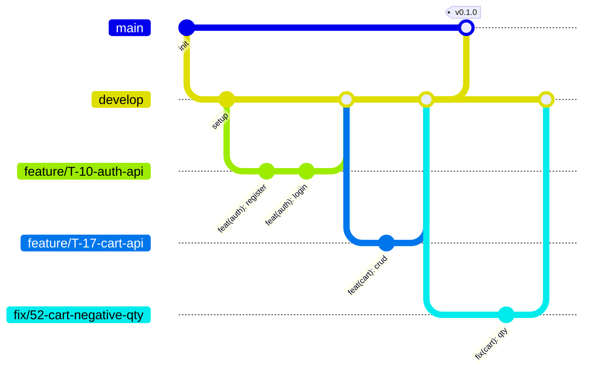

# 07 – Git Workflow

## 1. Mô hình branch



| Branch | Mục đích | Ai được merge vào | Quy tắc |
|--------|----------|-------------------|---------|
| `main` | Code sẵn sàng phát hành, dùng để demo và deploy | M1, chỉ qua PR từ `develop` | Cấm push trực tiếp; CI phải pass |
| `develop` | Nhánh tích hợp | M1, qua PR từ `feature/*`, `fix/*` | Cấm push trực tiếp; cần ít nhất 1 approve; CI phải pass |
| `feature/*` | Phát triển một task | Tác giả tự push | Tạo từ `develop`, tồn tại ngắn (dưới 1 tuần) |
| `fix/*` | Sửa lỗi | Tác giả tự push | Tạo từ `develop` |
| `docs/*` | Chỉ sửa tài liệu | Tác giả tự push | Tạo từ `develop` |

Cấu hình **branch protection** trên GitHub cho `main` và `develop`: yêu cầu Pull Request, yêu cầu 1 approval, yêu cầu status check `ci` pass, cấm force push.

## 2. Quy tắc đặt tên branch

```
<loại>/<mã>-<mô-tả-ngắn>
```

- `<loại>`: `feature`, `fix`, `docs`, `chore`.
- `<mã>`: Task ID trong doc 01 (ví dụ `T-10`) hoặc số Issue trên GitHub.
- `<mô-tả-ngắn>`: tiếng Anh, chữ thường, nối bằng gạch ngang, tối đa 5 từ.

| Đúng | Sai |
|------|-----|
| `feature/T-10-auth-api` | `feature/auth` (thiếu mã) |
| `feature/T-24-product-listing-ui` | `Feature/ProductListing` (viết hoa) |
| `fix/52-cart-negative-quantity` | `fix-bug` (không rõ nội dung) |
| `docs/update-api-orders` | `nam-branch` (đặt theo tên người) |

## 3. Quy tắc commit message

Theo [Conventional Commits](https://www.conventionalcommits.org/):

```
<type>(<scope>): <mô tả ngắn>

[phần thân tùy chọn: giải thích lý do]

[Refs: #<số issue>]
```

| Type | Dùng khi |
|------|----------|
| `feat` | Thêm chức năng |
| `fix` | Sửa lỗi |
| `docs` | Chỉ thay đổi tài liệu |
| `refactor` | Sửa code không đổi hành vi |
| `test` | Thêm hoặc sửa test |
| `chore` | Cấu hình, dependency, build |
| `style` | Format code |

`<scope>` là tên module: `auth`, `users`, `sellers`, `categories`, `products`, `inventory`, `cart`, `orders`, `payments`, `reviews`, `notifications`, `admin`, `web`, `db`, `ci`.

Quy tắc:

- Mô tả bằng tiếng Anh, động từ nguyên thể, chữ thường, không dấu chấm cuối, tối đa 72 ký tự.
- Mỗi commit là một thay đổi có nghĩa và chạy được. Không commit "wip", "update", "fix bug".
- Commit thường xuyên, ít nhất một lần mỗi buổi làm việc.

Ví dụ:

```
feat(auth): add refresh token rotation
fix(cart): reject quantity greater than stock
docs(api): document seller order status endpoint
test(orders): add checkout integration test for multi-seller cart
chore(db): add index on seller_orders(store_id, status)
```

## 4. Quy trình làm việc hằng ngày

```bash
# 1. Cập nhật develop
git checkout develop
git pull origin develop

# 2. Tạo branch cho task
git checkout -b feature/T-17-cart-api

# 3. Code, test, commit
git add apps/api/src/modules/cart
git commit -m "feat(cart): add cart item endpoints"

# 4. Đồng bộ với develop trước khi push (làm hằng ngày nếu task kéo dài)
git fetch origin
git rebase origin/develop        # hoặc: git merge origin/develop
npm run lint && npm test         # chạy trong thư mục ứng dụng vừa sửa

# 5. Push và tạo Pull Request vào develop
git push -u origin feature/T-17-cart-api
```

Sau đó:

6. Tạo Pull Request vào `develop`, điền template, gán reviewer.
7. Reviewer nhận xét trong vòng 24 giờ. Tác giả sửa và push thêm commit vào cùng branch.
8. Khi có approve và CI pass, M1 merge bằng **Squash and merge**, rồi xóa branch.
9. Cuối mỗi milestone: M1 tạo PR `develop` → `main`, cả nhóm chạy kiểm thử tích hợp (doc 08), merge bằng **Create a merge commit** và gắn tag phiên bản (`v0.1.0`, `v0.2.0`…).

Phân công review:

| Tác giả | Reviewer chính | Reviewer phụ |
|---------|----------------|--------------|
| M2 (Frontend) | M1 | M3 hoặc M4, tùy API liên quan |
| M3 (Backend Core) | M1 | M4 |
| M4 (Backend Commerce) | M1 | M3 |
| M1 (Leader) | M3 | M4 |

## 5. Tránh xung đột code

**Quyền sở hữu module.** Mỗi thư mục có một owner (doc 01 mục 5). Chỉ owner sửa code trong module của mình.

| Đường dẫn | Owner |
|-----------|-------|
| `apps/api/src/modules/{auth,users,sellers,categories,products}` | M3 |
| `apps/api/src/modules/{inventory,cart,orders,payments,reviews}` | M4 |
| `apps/api/src/modules/{notifications,admin}` | M1 |
| `apps/api/src/common`, `apps/api/src/app.module.ts`, `apps/api/prisma/schema.prisma` | M1 |
| `apps/web/src/app/(shop)`, `(auth)`, `seller` | M2 |
| `apps/web/src/app/admin` | M1 |
| `apps/web/src/components/ui`, `apps/web/src/lib` | M2 |
| `e2e/`, `apps/api/test/` | M4 |
| `docker-compose.yml`, `.github/` | M1 |

Khai báo bảng này trong `.github/CODEOWNERS` để GitHub tự gán reviewer.

**Khi cần sửa module của người khác:**

1. Tạo Issue mô tả nhu cầu, tag owner.
2. Owner tự sửa, hoặc đồng ý để người yêu cầu sửa.
3. Nếu người yêu cầu sửa, owner bắt buộc là reviewer của PR đó.

**File dùng chung dễ xung đột:**

| File | Quy tắc |
|------|---------|
| `schema.prisma` | Theo quy trình ở doc 04 mục 9. Mỗi thời điểm chỉ một PR sửa schema được mở; báo trong nhóm chat trước khi bắt đầu |
| `app.module.ts` | Mỗi module chỉ thêm đúng một dòng import của mình |
| `package.json`, lockfile | Thêm thư viện mới phải nêu trong mô tả PR; khi xung đột lockfile thì lấy bản của `develop` rồi chạy lại `npm install` |
| `docs/05_API_Documentation.md` | Mỗi người chỉ sửa mục thuộc module của mình |

**Giữ PR nhỏ.** Mục tiêu dưới 400 dòng thay đổi. Task lớn (ví dụ T-18) chia thành nhiều PR: tạo đơn, state machine, hủy đơn.

## 6. Pull Request template

Lưu tại `.github/pull_request_template.md`:

```markdown
## Mô tả
<!-- PR này làm gì và vì sao? -->

Closes #<số issue> · Task: T-xx

## Loại thay đổi
- [ ] feat – chức năng mới
- [ ] fix – sửa lỗi
- [ ] refactor
- [ ] docs
- [ ] test / chore

## Thay đổi chính
-
-

## Ảnh hưởng
- [ ] Thay đổi database schema (đã kèm migration và cập nhật docs/04)
- [ ] Thay đổi API contract (đã cập nhật docs/05)
- [ ] Thêm biến môi trường (đã cập nhật .env.example và docs/09)
- [ ] Thêm thư viện mới: <!-- tên và lý do -->
- [ ] Không có ảnh hưởng nào ở trên

## Cách kiểm thử
<!-- Các bước để reviewer tự kiểm tra -->
1.
2.

## Ảnh chụp màn hình
<!-- Bắt buộc với thay đổi giao diện -->

## Checklist của tác giả
- [ ] Đã tự review toàn bộ diff
- [ ] `npm run lint` và `npm test` pass ở máy local
- [ ] Đã viết hoặc cập nhật test cho logic mới
- [ ] Không có secret, `console.log` thừa, code bị comment
- [ ] Đã rebase/merge `develop` mới nhất
```

## 7. Issue templates

Lưu trong `.github/ISSUE_TEMPLATE/`.

**`feature.md`**

```markdown
---
name: Feature / Task
about: Một chức năng hoặc công việc cần làm
labels: feature
---

## Mô tả
<!-- Cần làm gì? Cho vai trò nào? -->

**Task ID:** T-xx · **Module:** · **Use case / FR liên quan:**

## Acceptance Criteria
- [ ]
- [ ]

## Phụ thuộc
<!-- Issue hoặc task phải xong trước -->

## Ghi chú kỹ thuật
<!-- Endpoint, bảng, component liên quan -->
```

**`bug.md`**

```markdown
---
name: Bug report
about: Báo lỗi
labels: bug
---

## Mô tả lỗi

## Các bước tái hiện
1.
2.
3.

## Kết quả mong đợi

## Kết quả thực tế
<!-- Kèm ảnh chụp, response API, log nếu có -->

## Môi trường
- Branch / commit:
- Trình duyệt:
- Tài khoản test (role):

## Mức độ
- [ ] P0 – chặn luồng chính
- [ ] P1 – sai chức năng, có cách tránh
- [ ] P2 – lỗi nhỏ, giao diện
```

Nhãn (label) sử dụng: `feature`, `bug`, `docs`, `database`, `frontend`, `backend`, `P0`, `P1`, `P2`, `blocked`.

Quản lý tiến độ bằng GitHub Projects dạng bảng với các cột: **Backlog → To Do → In Progress → In Review → Done**.

## 8. Code review checklist

Dành cho reviewer.

**Đúng yêu cầu**

- [ ] Code thực hiện đúng acceptance criteria của Issue.
- [ ] Endpoint khớp với docs/05: URL, method, request, response, mã lỗi.
- [ ] Đã xử lý các trường hợp biên: dữ liệu rỗng, không tìm thấy, trùng lặp.

**Kiến trúc**

- [ ] Controller không chứa business logic; service không phụ thuộc HTTP.
- [ ] Module không truy cập trực tiếp bảng của module khác (trừ truy vấn chỉ đọc).
- [ ] Thao tác ghi nhiều bảng được bọc trong transaction.
- [ ] Không lặp lại code đã có sẵn trong `common/` hoặc `lib/`.

**Bảo mật**

- [ ] Endpoint có guard và role phù hợp.
- [ ] Có kiểm tra quyền sở hữu tài nguyên (user chỉ thao tác dữ liệu của mình).
- [ ] Input được validate bằng DTO.
- [ ] Response không lộ `passwordHash`, token, hay dữ liệu của người khác.
- [ ] Không có secret trong code.

**Chất lượng**

- [ ] Tên biến, hàm rõ nghĩa; không dùng `any` khi không cần thiết.
- [ ] Lỗi được ném bằng exception chuẩn kèm mã lỗi, không nuốt lỗi.
- [ ] Truy vấn danh sách có phân trang; không có truy vấn N+1 rõ ràng.
- [ ] Có test cho logic mới; test thực sự kiểm tra hành vi.

**Frontend**

- [ ] Có trạng thái loading, lỗi, rỗng.
- [ ] Hiển thị tốt ở 360px và desktop.
- [ ] Form có validate và thông báo lỗi tiếng Việt.

**Cách nhận xét:** nêu vấn đề kèm đề xuất cụ thể; phân biệt rõ điều bắt buộc sửa và điều góp ý (tiền tố `nit:`); nhận xét về code, không về người viết.

## 9. Definition of Done

Một task được coi là hoàn thành khi **tất cả** điều sau đúng:

1. Code đáp ứng mọi acceptance criteria của task.
2. Lint và type check không có lỗi.
3. Có unit test cho business logic mới; toàn bộ test pass trên CI.
4. Với API: endpoint xuất hiện đúng trong Swagger và khớp docs/05.
5. Với giao diện: đã kiểm tra trên mobile và desktop, có đủ trạng thái loading, lỗi, rỗng.
6. Tài liệu liên quan đã cập nhật (API, database, biến môi trường).
7. PR được ít nhất một người approve và đã merge vào `develop`.
8. Chức năng chạy được trên môi trường Docker Compose sau khi merge.
9. Issue đã được đóng và chuyển sang cột Done.

## 10. Quy tắc về secret

- Không commit `.env`, khóa API, mật khẩu, JWT secret. `.gitignore` phải có `.env*` và ngoại lệ `!.env.example`.
- `.env.example` liệt kê đủ tên biến với giá trị giả.
- Secret thật chia sẻ qua kênh riêng của nhóm, không qua GitHub Issue hay PR.
- Secret cho CI/CD đặt trong GitHub Actions Secrets.
- Nếu lỡ commit secret: **đổi secret đó ngay lập tức** (xóa commit là không đủ vì lịch sử đã lộ), rồi báo M1.

## 11. Continuous Integration

GitHub Actions chạy trên mỗi Pull Request vào `develop` và `main`:

| Job | Nội dung |
|-----|----------|
| `lint` | Lint và kiểm tra kiểu (`tsc --noEmit`) cho cả `api` và `web` |
| `test-api` | Jest unit test và integration test, với service PostgreSQL |
| `build` | `nest build` và `next build` |
| `e2e` | Playwright, chỉ chạy trên PR vào `main` |

## 12. Thiết lập repository lần đầu

Việc của M1 (task T-05), làm một lần. Thư mục dự án đã có sẵn `.gitignore`, `.gitattributes`, `.editorconfig` và các template trong `.github/`.

1. Tạo repository rỗng trên GitHub (không chọn thêm README, `.gitignore` hay license).
2. Tại thư mục dự án, tạo commit đầu tiên và hai nhánh chính:

   ```bash
   git init -b main
   git add .
   git commit -m "chore: initialize repository with docs and GitHub templates"
   git remote add origin <repo-url>
   git push -u origin main
   git switch -c develop
   git push -u origin develop
   ```

3. Trên GitHub:
   - Mời 3 thành viên còn lại làm collaborator.
   - Đặt `develop` làm default branch để Pull Request mặc định trỏ vào `develop`.
   - Bật branch protection cho `main` và `develop` theo mục 1. Status check `ci` chỉ chọn được sau khi workflow CI đã chạy ít nhất một lần (task T-08).
   - Tạo các nhãn ở mục 7. Template Issue chỉ gắn được nhãn đã tồn tại.
   - Tạo GitHub Project dạng bảng với các cột ở mục 7, rồi tạo Issue cho các task của tuần 1–2.
4. Điền username GitHub của từng thành viên vào `.github/CODEOWNERS` theo hướng dẫn ở đầu file.

Với gói GitHub Free, branch protection chỉ có hiệu lực trên repository public. Muốn để repository private thì tài khoản chủ repository cần GitHub Pro; sinh viên được dùng miễn phí qua GitHub Student Developer Pack.

File `.gitattributes` quy định mọi file văn bản dùng ký tự xuống dòng LF, kể cả trên Windows. Nhờ vậy diff không bị nhiễu bởi CRLF, và script shell không hỏng khi chạy trong container Linux.
