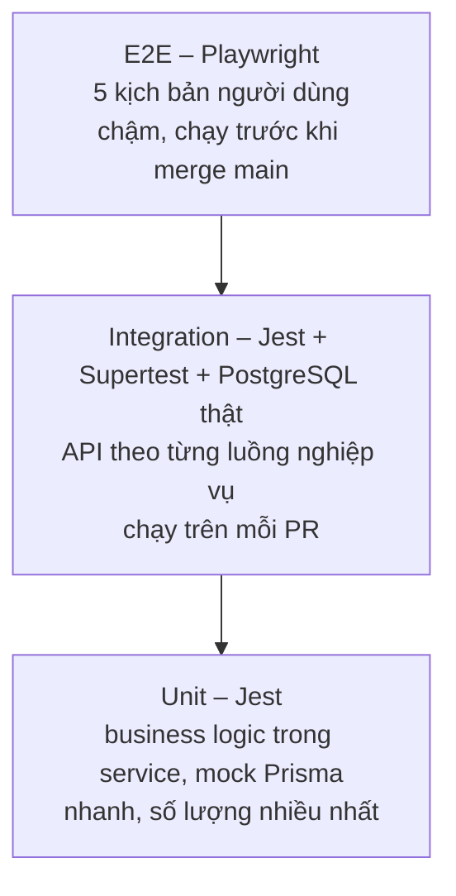

# 08 – Testing Plan

## 1. Mục tiêu

- Phát hiện lỗi sớm, ngay trong module, trước khi tích hợp.
- Bảo vệ các luồng liên quan đến tiền và tồn kho bằng test tự động.
- Đảm bảo kịch bản nghiệm thu MVP (doc 02 mục 5) chạy được sau mỗi lần merge vào `main`.

## 2. Chiến lược



| Cấp độ | Công cụ | Phạm vi | Ai viết | Khi chạy |
|--------|---------|---------|---------|----------|
| Unit | Jest | Một service, phụ thuộc được mock | Owner của module | Mỗi commit (local), mỗi PR (CI) |
| Integration | Jest + Supertest | HTTP → controller → service → database test | M4 (Commerce), M3 (Core) | Mỗi PR |
| E2E | Playwright | Trình duyệt → frontend → backend → database | M4, M2 hỗ trợ selector | PR vào `main`, trước demo |
| Thủ công | Checklist | Giao diện, responsive, trường hợp khó tự động hóa | Cả nhóm | Cuối mỗi milestone |

Mục tiêu coverage: tầng service ≥ 70%; riêng `orders`, `payments`, `inventory` ≥ 80%. Coverage là chỉ số tham khảo; điều quan trọng là các quy tắc nghiệp vụ ở mục 3 đều có test.

**Nhịp kiểm thử theo lịch 8 tuần** (doc 01 mục 6):

- Tuần 2–5: unit test nằm trong cùng Pull Request với chức năng.
- Từ tuần 5: integration test cho luồng tiền và tồn kho (IT-06 đến IT-11), ngay khi Order và Payment xong.
- Tuần 6–7: các integration test còn lại; E2E theo thứ tự E2E-01, 02, 05, rồi E2E-03, 04 khi Seller Center hoàn tất.

Nếu thiếu thời gian, giữ lại theo thứ tự ưu tiên: IT-06 đến IT-11, rồi IT-01 đến IT-05, rồi E2E-01, 02, 04.

## 3. Unit test

Đặt cạnh file nguồn: `orders.service.ts` → `orders.service.spec.ts`. Mock `PrismaService` bằng `jest-mock-extended`.

Đặt tên test theo mẫu: `should <kết quả> when <điều kiện>`.

### 3.1 Các trường hợp bắt buộc theo module

| Module | Trường hợp cần test |
|--------|---------------------|
| Auth | Đăng ký thành công thì mật khẩu được hash; email trùng bị từ chối; sai mật khẩu trả `INVALID_CREDENTIALS`; tài khoản BANNED không đăng nhập được; refresh xoay vòng token; dùng lại token đã thu hồi thì thu hồi tất cả; `RolesGuard` chặn sai role |
| Users | Địa chỉ đầu tiên tự thành mặc định; đặt mặc định mới thì bỏ mặc định cũ; không sửa được địa chỉ của người khác; vượt 10 địa chỉ bị từ chối; đổi mật khẩu sai mật khẩu cũ bị từ chối |
| Sellers | Đăng ký hai lần bị từ chối; duyệt thì gán role SELLER; chuyển trạng thái không hợp lệ bị từ chối; hồ sơ REJECTED sửa xong quay về PENDING |
| Categories | Không tạo được cấp 3; không xóa danh mục có con hoặc có sản phẩm |
| Products | Tạo sản phẩm kèm variant và tồn kho; SKU trùng bị từ chối; không gán được vào danh mục không phải lá; không ACTIVE khi thiếu ảnh; Seller không sửa được sản phẩm store khác; sản phẩm BANNED không tự mở lại được; `minPrice` được tính lại khi sửa variant |
| Search | Chỉ trả sản phẩm ACTIVE của seller APPROVED; lọc danh mục cha gồm danh mục con; lọc khoảng giá; từng kiểu sắp xếp; `limit` vượt 100 bị từ chối |
| Inventory | `decrease` thành công khi đủ hàng; ném `INSUFFICIENT_STOCK` khi thiếu; `increase` cộng đúng; Seller không sửa được kho của store khác |
| Cart | Thêm trùng variant thì cộng dồn; vượt tồn kho bị từ chối; không mua được hàng của chính mình; item ngừng bán có `available = false`; `subtotal` bỏ qua item không khả dụng |
| Orders | Giỏ 2 store tạo 2 seller order; tổng tiền tính đúng theo công thức doc 04; snapshot giá đúng; địa chỉ của người khác bị từ chối; mọi chuyển trạng thái hợp lệ và không hợp lệ trong bảng doc 04 mục 5.1; hủy đơn gọi hoàn kho; trạng thái order tổng được tính lại đúng |
| Payments | COD tạo payment PENDING và order PROCESSING; chữ ký VNPay sai bị từ chối; số tiền không khớp bị từ chối; IPN lặp không cập nhật lần hai; payment hết hạn thì hủy đơn; retry tạo payment mới |
| Reviews | Không review được item chưa giao; không review hai lần; không review item của người khác; không sửa sau 7 ngày; rating trung bình tính đúng và bỏ qua review bị ẩn |
| Notifications | Mỗi event tạo đúng thông báo cho đúng người; lỗi khi tạo thông báo không ném ra ngoài |
| Admin | Không tự khóa chính mình; khóa user thì thu hồi refresh token; doanh thu chỉ tính đơn COMPLETED |

### 3.2 Ví dụ

```ts
describe('InventoryService.decrease', () => {
  it('should throw INSUFFICIENT_STOCK when quantity is not enough', async () => {
    prisma.$executeRaw.mockResolvedValue(0); // không dòng nào được cập nhật

    await expect(service.decrease(prisma, 'variant-1', 5))
      .rejects.toMatchObject({ code: 'INSUFFICIENT_STOCK' });
  });
});
```

## 4. Integration test

Đặt tại `apps/api/test/`. Chạy ứng dụng NestJS thật với database PostgreSQL riêng cho test (`marketplace_test`), gọi API bằng Supertest. Trước mỗi file test: xóa dữ liệu và seed dữ liệu tối thiểu qua các hàm factory (`createUser`, `createSellerWithStore`, `createProduct`).

Cổng thanh toán được thay bằng provider giả; riêng việc kiểm tra chữ ký VNPay được test bằng dữ liệu ký sẵn với secret test.

| ID | Kịch bản | Kiểm tra |
|----|----------|----------|
| IT-01 | Đăng ký → đăng nhập → gọi API cần đăng nhập → refresh → logout | Token hoạt động; sau logout refresh bị từ chối |
| IT-02 | Phân quyền | Customer gọi `/api/seller/*` và `/api/admin/*` nhận 403; không token nhận 401 |
| IT-03 | Luồng seller: đăng ký → Admin duyệt → tạo sản phẩm → đăng bán | Sản phẩm xuất hiện trong `GET /api/products` |
| IT-04 | Seller chưa duyệt gọi `POST /api/seller/products` | 403 `SELLER_NOT_APPROVED` |
| IT-05 | Seller A sửa sản phẩm của Seller B | 404; dữ liệu không đổi |
| IT-06 | Checkout COD với giỏ gồm 2 store | 1 order, 2 seller order; tồn kho giảm đúng; giỏ trống; order PROCESSING |
| IT-07 | Checkout khi một item thiếu hàng | 409; không có order nào được tạo; tồn kho của các item khác không đổi (rollback) |
| IT-08 | **Đồng thời:** tồn kho 1, gửi 5 request checkout song song | Đúng 1 request thành công, 4 request nhận 409; tồn kho cuối bằng 0 |
| IT-09 | Thanh toán VNPay thành công qua IPN | Payment PAID, order PROCESSING; gọi IPN lần hai không thay đổi gì |
| IT-10 | IPN sai chữ ký hoặc sai số tiền | Trạng thái không đổi |
| IT-11 | Payment hết hạn | Order CANCELLED; tồn kho được hoàn |
| IT-12 | Seller xác nhận đơn VNPay chưa thanh toán | 409 `ORDER_NOT_PAID` |
| IT-13 | Vòng đời đầy đủ: PENDING → CONFIRMED → SHIPPING → DELIVERED → COMPLETED | Thời điểm được ghi; order tổng COMPLETED; `soldCount` tăng |
| IT-14 | Customer hủy seller order PENDING | Tồn kho hoàn; seller order còn lại không bị ảnh hưởng |
| IT-15 | Seller A xem đơn | Không thấy seller order của Seller B trong cùng order |
| IT-16 | Customer A xem đơn của Customer B | 404 |
| IT-17 | Review sau khi DELIVERED | Thành công; `ratingAvg` và `ratingCount` của sản phẩm cập nhật; review lần hai nhận 409 |
| IT-18 | Tìm kiếm không dấu: tìm "ao thun" | Trả về sản phẩm "Áo thun" |
| IT-19 | Admin khóa user | User đó đăng nhập và refresh đều bị từ chối |
| IT-20 | Thông báo | Seller nhận thông báo đơn mới; Customer nhận thông báo đổi trạng thái |

IT-08 là test quan trọng nhất của hệ thống vì nó kiểm chứng yêu cầu FR-INV-04.

## 5. End-to-end test

Đặt tại `e2e/`. Chạy trên môi trường Docker Compose với dữ liệu seed. Dùng `data-testid` cho các phần tử quan trọng để test không phụ thuộc vào CSS.

Tài khoản seed dùng cho test:

| Email | Role | Ghi chú |
|-------|------|---------|
| `admin@example.com` | ADMIN | |
| `seller1@example.com` | SELLER | Store có sẵn sản phẩm |
| `seller2@example.com` | SELLER | Store có sẵn sản phẩm |
| `customer@example.com` | CUSTOMER | Có sẵn một địa chỉ |

Mật khẩu của các tài khoản này chỉ dùng cho môi trường development và test, đặt trong biến môi trường của script seed.

| ID | Kịch bản | Các bước chính |
|----|----------|----------------|
| E2E-01 | Guest duyệt sản phẩm | Mở trang chủ → tìm kiếm → lọc theo danh mục và giá → mở chi tiết sản phẩm |
| E2E-02 | Đăng ký và mua hàng COD | Đăng ký → thêm địa chỉ → thêm 2 sản phẩm của 2 store vào giỏ → checkout COD → thấy đơn trong lịch sử với 2 phần đơn |
| E2E-03 | Trở thành người bán | Customer gửi hồ sơ → Admin đăng nhập và duyệt → Seller tạo sản phẩm kèm ảnh → sản phẩm tìm thấy được ở trang công khai |
| E2E-04 | Xử lý đơn và đánh giá | Seller xác nhận → giao → đã giao → Customer xác nhận nhận hàng → viết review → review hiển thị ở trang sản phẩm |
| E2E-05 | Quản trị | Admin khóa một user → user đó không đăng nhập được; Admin cấm một sản phẩm → sản phẩm biến mất khỏi tìm kiếm |

Thanh toán VNPay không đưa vào E2E tự động vì phụ thuộc trang bên ngoài; phần này được bao phủ bởi integration test (IT-09 đến IT-11) và kiểm thử thủ công.

## 6. Security testing

Kiểm tra thủ công theo checklist, thực hiện ở Phase 5 (task T-32).

| # | Hạng mục | Cách kiểm tra | Kết quả mong đợi |
|---|----------|---------------|------------------|
| 1 | Xác thực | Gọi API cần đăng nhập khi không có token, token sai, token hết hạn | 401 |
| 2 | Phân quyền theo role | Dùng token Customer gọi mọi endpoint `/api/seller/*`, `/api/admin/*` | 403 |
| 3 | IDOR | Dùng token user A truy cập đơn hàng, địa chỉ, cart item, thông báo, review của user B bằng cách đổi id | 404 |
| 4 | IDOR giữa các seller | Seller A sửa sản phẩm, tồn kho, đơn của Seller B | 404 |
| 5 | Mass assignment | Gửi thêm `roles`, `status`, `price`, `storeId` vào body đăng ký, sửa hồ sơ, tạo đơn | Field thừa bị loại bỏ (`whitelist: true`, `forbidNonWhitelisted: true`) |
| 6 | Giá do client gửi | Gửi `unitPrice` hoặc `total` trong body tạo đơn | Bị từ chối; giá luôn lấy từ database |
| 7 | Injection | Nhập `' OR 1=1 --` vào tìm kiếm và đăng nhập | Không lỗi 500, không lộ dữ liệu |
| 8 | XSS | Nhập `<script>alert(1)</script>` vào tên sản phẩm, review, tên store | Hiển thị dạng văn bản, không thực thi |
| 9 | Brute force | Đăng nhập sai liên tục | 429 sau ngưỡng cho phép |
| 10 | Upload | Tải lên file `.exe` đổi đuôi `.jpg`, file lớn hơn 5MB | Bị từ chối |
| 11 | Callback thanh toán | Gọi IPN với chữ ký sai, số tiền sai | Trạng thái không đổi |
| 12 | Lộ thông tin | Kiểm tra response của mọi endpoint trả `user` | Không có `passwordHash`; lỗi 500 không trả stack trace |
| 13 | Secret | Chạy `git log -p` tìm khóa; kiểm tra `.gitignore` | Không có secret trong lịch sử |
| 14 | Dependency | `npm audit --omit=dev` | Không có lỗ hổng mức high hoặc critical chưa xử lý |
| 15 | Header và CORS | Kiểm tra response header; gọi API từ origin lạ | Có header của Helmet; origin lạ bị chặn |

## 7. Kiểm thử thủ công

Thực hiện cuối mỗi milestone, mỗi thành viên kiểm tra phần của người khác.

- **Responsive:** 360px, 768px, 1280px cho mọi trang Customer.
- **Trình duyệt:** Chrome, Edge, Firefox.
- **Trạng thái giao diện:** loading, rỗng, lỗi mạng (tắt backend rồi thao tác).
- **Thanh toán VNPay sandbox:** thành công, hủy giữa chừng, để hết hạn, thanh toán lại.
- **Phiên đăng nhập:** để quá 15 phút rồi thao tác tiếp (kiểm tra tự refresh); đăng xuất ở tab này rồi thao tác ở tab khác.
- **Hai tab:** mở cùng một đơn ở hai tab, xử lý ở cả hai.

## 8. Môi trường và lệnh chạy

| Môi trường | Database | Mục đích |
|------------|----------|----------|
| Local | `marketplace_dev` | Phát triển |
| Test | `marketplace_test` | Integration test; bị xóa dữ liệu mỗi lần chạy |
| CI | Service PostgreSQL của GitHub Actions | Chạy tự động |
| E2E | Docker Compose + seed | Playwright |

Các lệnh dự kiến (được cấu hình ở Phase 3), chạy trong thư mục `apps/api`:

```bash
npm test              # unit test
npm run test:cov      # unit test kèm coverage
npm run test:int      # integration test
```

Project do công cụ khởi tạo của NestJS sinh ra gọi loại test thứ ba là `test:e2e` và đặt file với đuôi `.e2e-spec.ts`. Trong tài liệu này đó là integration test; tên E2E dành cho Playwright, chạy từ thư mục `e2e/`. Người khởi tạo backend (T-06) đổi tên script thành `test:int` cho khớp.

## 9. Quản lý lỗi

1. Người phát hiện tạo Issue theo mẫu Bug report (doc 07 mục 7), gắn nhãn mức độ.
2. M1 gán cho owner của module.
3. Owner viết test tái hiện lỗi trước, sau đó sửa, tạo PR `fix/*`.
4. Người báo lỗi xác nhận và đóng Issue.

| Mức | Định nghĩa | Thời hạn xử lý |
|-----|------------|----------------|
| P0 | Chặn luồng chính, sai tiền, sai tồn kho, lỗ hổng bảo mật | Trong ngày |
| P1 | Chức năng sai nhưng có cách tránh | Trong 3 ngày |
| P2 | Lỗi giao diện nhỏ | Trước khi phát hành, nếu kịp |

**Tiêu chí hoàn thành Phase 5:** mọi unit và integration test pass; 5 kịch bản E2E pass; checklist bảo mật không còn mục thất bại; không còn bug P0, P1 đang mở.
