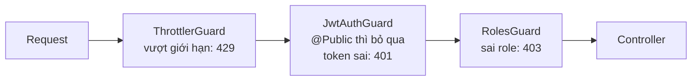
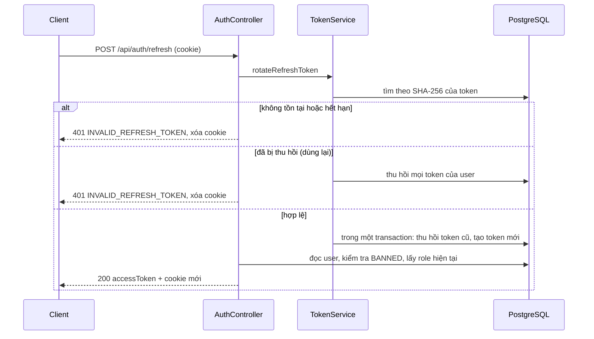

# 11 – T-10 Auth API: cách thực hiện

- **Task:** T-10 (M3, P0), xem [01 – Project Overview](01_Project_Overview.md) mục 7.2.
- **Nhánh:** `feature/T-10-auth-api`, commit `ee51dd1`, đã có trên GitHub.
- **Thực hiện:** 25/11/2026, có dùng trợ lý AI (Claude), ghi nhận ở dòng `Co-Authored-By` của commit.
- **Trạng thái:** đã sửa lỗi tương thích `@nestjs/jwt` với Jest CommonJS và hoàn tất kiểm chứng tự động (`lint:check`, `typecheck`, 86/86 unit test, 22/22 e2e test, `build` đều pass). Còn bước chạy thử thủ công với PostgreSQL thật khi bật Docker Desktop (mục 8).

## 1. Phạm vi

- 5 endpoint theo [05 – API Documentation](05_API_Documentation.md) mục 3: `register`, `login`, `refresh`, `logout`, `me`.
- Thành phần dùng chung cho các module khác: `JwtAuthGuard`, `RolesGuard`, `@Public()`, `@Roles()`, `@CurrentUser()`.
- Yêu cầu liên quan: FR-AUTH-03 đến FR-AUTH-06, NFR-06 (giới hạn đăng nhập).
- Ngoài phạm vi: hồ sơ và địa chỉ (T-11), kiểm tra seller đã duyệt (T-12), Admin khóa user (T-22), giao diện đăng nhập (T-23).

## 2. Các bước thực hiện

1. Đọc yêu cầu (doc 02), use case (doc 06), danh sách test bắt buộc (doc 08 mục 3.1) và API contract (doc 05 mục 3).
2. Tạo nhánh `feature/T-10-auth-api` từ `develop` đã merge T-06, T-07, T-09.
3. Kiểm tra phiên bản và API của `@nestjs/jwt`, `@nestjs/throttler` đang cài.
4. Viết phần dùng chung trong `src/common/`: kiểu `AuthUser`, `Role`, ba decorator, hai guard.
5. Viết module `auth` theo thứ tự: cookie và `TokenService` → DTO → `AuthService` → `AuthController`.
6. Nối vào `AppModule`, đánh dấu health check là `@Public()`.
7. Siết kiểm tra biến môi trường và sửa test tương ứng.
8. Bỏ các gói Passport không dùng, thêm `jest-mock-extended`.
9. Viết unit test và test e2e.
10. Cập nhật doc 03, 05, 09.

## 3. Cấu trúc file

Đường dẫn tính từ `apps/api/`.

| File | Vai trò |
|------|---------|
| `src/modules/auth/auth.controller.ts` | 5 endpoint, đặt và xóa cookie, rate limit |
| `src/modules/auth/auth.service.ts` | Nghiệp vụ đăng ký, đăng nhập, refresh, đăng xuất, me |
| `src/modules/auth/token.service.ts` | Ký access token; cấp, xoay vòng, thu hồi refresh token |
| `src/modules/auth/refresh-cookie.ts` | Thuộc tính cookie `refreshToken` |
| `src/modules/auth/auth.module.ts` | Cấu hình `JwtModule` (global), export `TokenService` |
| `src/modules/auth/dto/` | DTO đầu vào (kèm message tiếng Việt) và đầu ra cho Swagger |
| `src/common/auth/auth-user.ts` | Kiểu `Role`, `AuthUser`, payload của access token |
| `src/common/guards/` | `JwtAuthGuard`, `RolesGuard` |
| `src/common/decorators/` | `public`, `roles`, `current-user` |
| `src/app.module.ts` | Đăng ký guard toàn cục |
| `src/config/env.validation.ts` | Kiểm tra biến JWT |
| `src/**/*.spec.ts`, `test/app.e2e-spec.ts`, `test/setup-env.ts` | Test |

## 4. Cơ chế hoạt động

### 4.1 Thứ tự guard

Mọi request đi qua ba guard toàn cục theo thứ tự khai báo trong `AppModule`:



### 4.2 Hai loại token

| | Access token | Refresh token |
|---|--------------|---------------|
| Dạng | JWT (HS256), payload `sub`, `email`, `roles` | 32 byte ngẫu nhiên, mã hóa base64url |
| Thời hạn | `JWT_ACCESS_EXPIRES_IN`, mặc định 15 phút | `REFRESH_TOKEN_EXPIRES_DAYS`, mặc định 7 ngày |
| Gửi đi | Header `Authorization: Bearer` | Cookie `httpOnly`, `Path=/api/auth` |
| Lưu ở server | Không lưu | Chỉ lưu SHA-256 trong bảng `refresh_tokens` |

### 4.3 Refresh và xoay vòng



Việc đọc user và ký access token do `AuthService` thực hiện; sơ đồ gộp vào `AuthController` cho gọn.

## 5. Quyết định thiết kế

| Quyết định | Lý do |
|------------|-------|
| Mặc định mọi route cần đăng nhập, mở bằng `@Public()` | Quên đánh dấu thì route bị khóa, không bị lộ |
| Refresh token là chuỗi ngẫu nhiên, lưu SHA-256 | Database lộ cũng không dùng được token. Chuỗi 256 bit không dò được nên không cần hash chậm, và hash cố định cho phép tra cứu trực tiếp |
| Mỗi refresh token dùng một lần; dùng lại thì thu hồi tất cả | Token bị dùng lại là dấu hiệu bị lộ |
| Thu hồi bằng `updateMany` kèm điều kiện `revokedAt: null` | Hai request đồng thời chỉ một request thắng |
| Đăng nhập với email không tồn tại vẫn so sánh với một hash giả | Giảm chênh lệch thời gian phản hồi giúp dò email |
| Sai email và sai mật khẩu trả cùng `INVALID_CREDENTIALS` | Không lộ tài khoản nào tồn tại qua đăng nhập |
| Kiểm tra BANNED sau khi kiểm tra mật khẩu | Người không biết mật khẩu không dò được tài khoản bị khóa |
| Bắt `P2002` khi đăng ký | Hai request cùng email đồng thời vẫn nhận 409 thay vì 500 |
| Email được cắt khoảng trắng và đổi chữ thường ở DTO | Unique của PostgreSQL phân biệt hoa thường |
| Cố định thuật toán HS256 khi kiểm tra token | Chống đổi thuật toán trong header |
| `register`, `login` giới hạn 10 request/phút/IP | NFR-06, chống dò mật khẩu |
| Cookie `SameSite=Lax`, `Secure` ở production | Hạn chế CSRF, chỉ gửi qua HTTPS khi chạy thật |
| `refresh` đọc lại role từ database | Seller vừa được duyệt nhận role mới sau khi refresh |
| Bỏ Passport, viết guard dùng thẳng `JwtService` | Chỉ có một cách xác thực, bớt phụ thuộc |

## 6. Hướng dẫn cho các module khác

```ts
@Controller('products')
export class ProductsController {
  @Public()                       // không cần đăng nhập
  @Get()
  list() {}

  @Get('mine')                    // mặc định: chỉ cần đăng nhập
  mine(@CurrentUser('id') userId: string) {}

  @Roles(Role.ADMIN)              // sai role: 403
  @Delete(':id')
  remove(@CurrentUser() user: AuthUser) {}
}
```

- Không tin `userId` do client gửi; luôn lấy từ `@CurrentUser()`.
- `@Roles(Role.SELLER)` chưa kiểm tra seller đã `APPROVED`; T-12 làm phần này.
- T-22 khi khóa user gọi `TokenService.revokeAllForUser(userId)` (đã export từ `AuthModule`).

**Biến môi trường:** `JWT_ACCESS_SECRET` bắt buộc ở mọi môi trường, tối thiểu 32 ký tự; `JWT_ACCESS_EXPIRES_IN` phải có dạng số kèm `s`, `m`, `h` hoặc `d`. Xem [09 – Deployment Guide](09_Deployment_Guide.md) mục 3.

**Cần seed trước khi đăng ký:** bảng `roles` phải có `CUSTOMER`.

## 7. Test đã viết

| Nhóm | Trường hợp |
|------|-----------|
| `AuthService` | Hash mật khẩu và gán `CUSTOMER`; email trùng, kể cả đồng thời; đăng nhập đúng, sai mật khẩu, email không tồn tại, `BANNED`; refresh lấy role hiện tại; refresh của user `BANNED`; logout |
| `TokenService` | Payload access token; chỉ lưu hash; xoay vòng; dùng lại token; xoay đồng thời; hết hạn; token thiếu hoặc lạ; logout |
| `JwtAuthGuard`, `RolesGuard` | `@Public()`; thiếu token; token sai; payload thiếu trường; role lạ bị loại; đúng role, sai role, chưa đăng nhập |
| e2e (database được mock) | 401 khi thiếu, sai, hết hạn token; `@CurrentUser()`; 403 sai role; message validation tiếng Việt; refresh không cookie; rate limit đăng nhập |

## 8. Trạng thái kiểm chứng

Cập nhật 26/11/2026 (sau khi hạ `@nestjs/jwt` từ `^12.0.5` ESM-only xuống `^11.0.2` CommonJS khớp NestJS 11 và bổ sung chặn placeholder `JWT_ACCESS_SECRET` ở production — mục O2):

| Bước | Kết quả |
|------|---------|
| `prisma validate`, `prisma generate` | Pass |
| `lint:check` | Pass |
| `typecheck` | Pass |
| Unit test (`npm test -- --maxWorkers=2`) | **Pass** (11/11 suites, 86/86 tests) |
| Test e2e (`npm run test:e2e`) | **Pass** (1/1 suite, 22/22 tests) |
| Build (`npm run build`) | **Pass** |
| Thử với PostgreSQL thật và seed data | **Chưa chạy** (chờ bật Docker Desktop) |
| CI trên GitHub | **Chưa xác nhận.** CI chỉ chạy khi có PR hoặc push vào `develop`, `main` |

Lần chạy lại trên bản clone `~/projects/it4409` ngày 25/11 cũng dừng vì lỗi `Wsl/Service/0x8007274c` ([doc 10](10_Phase1-3_Issues_and_Solutions.md), mục 5).

### 8.1 Cách hoàn tất kiểm chứng

Cách đơn giản nhất là mở PR `feature/T-10-auth-api` vào `develop` để CI chạy lint, typecheck, unit test, e2e và build.

Chạy ở máy, trong terminal Ubuntu:

```bash
cd ~/projects/it4409/apps/api
git switch feature/T-10-auth-api
npm ci && npx prisma generate
npm run lint:check && npm run typecheck
npm test -- --maxWorkers=2
npm run test:e2e
npm run build
```

Thử với database thật (cần `apps/api/.env`, tạo từ `.env.example` và đổi `JWT_ACCESS_SECRET`):

```bash
cd ~/projects/it4409
docker compose up -d postgres
cd apps/api
npx prisma migrate deploy
npx prisma db seed
npm run start:dev
```

Mở `http://localhost:4000/api/docs`, đăng nhập bằng `customer@example.com` với mật khẩu `SEED_USER_PASSWORD`, rồi kiểm tra:

- [ ] `me` với access token trả đúng role.
- [ ] `refresh` đổi cookie; gửi lại cookie cũ bị 401 và mọi phiên bị thu hồi.
- [ ] `logout` xong thì `refresh` bị từ chối.
- [ ] Tài khoản `BANNED` không đăng nhập và không refresh được.
- [ ] Lần đăng nhập thứ 11 trong một phút nhận 429.

Xem dữ liệu bảng `refresh_tokens` bằng Prisma Studio (terminal khác, trong `apps/api`):

```bash
npx prisma studio --port 5555
```

## 9. Hạn chế đã biết

Các mục này rút ra từ đọc code, chưa tái hiện bằng test.

| Hạn chế | Ảnh hưởng | Hướng xử lý |
|---------|-----------|-------------|
| Hai tab refresh cùng lúc bằng cùng một cookie bị coi là dùng lại token | Người dùng bị đăng xuất khỏi mọi phiên | Khi làm T-23, đồng bộ refresh giữa các tab, hoặc cho token vừa xoay một khoảng ân hạn ngắn |
| Guard không đọc database | User bị khóa vẫn dùng được access token tới khi hết hạn (mặc định 15 phút) | Chấp nhận trong MVP |
| bcrypt chỉ dùng 72 byte đầu, trong khi DTO giới hạn 72 ký tự | Mật khẩu dài có dấu tiếng Việt bị cắt bớt phần cuối | Giới hạn theo byte trong `register` và đổi mật khẩu (T-11) |
| Refresh token hết hạn hoặc đã thu hồi không được xóa | Bảng `refresh_tokens` tăng dần | Thêm tác vụ dọn định kỳ |
| Bộ đếm rate limit nằm trong bộ nhớ | Mất khi khởi động lại; không dùng chung giữa nhiều instance | Chuyển sang Redis nếu chạy nhiều instance |
| `register` trả `EMAIL_ALREADY_EXISTS` | Dò được email đã đăng ký (theo API contract) | Chấp nhận, đã có rate limit |

Lỗi Prisma khác ngoài đăng ký vẫn trả 500, xem [doc 10](10_Phase1-3_Issues_and_Solutions.md) mục 6, O1.
