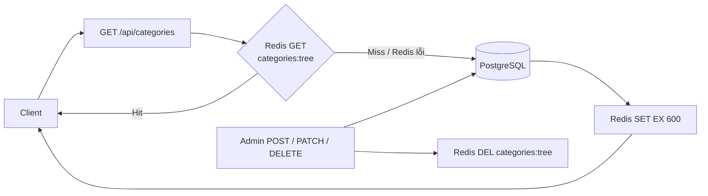

# 13 – T-13 & T-15 (Catalog & Search): tổng kết triển khai

- **Phạm vi:** Phần việc **Người 2 – Catalog & Search** không phụ thuộc T-11/T-12:
  - Mục mở **O1** ([doc 10](10_Phase1-3_Issues_and_Solutions.md) mục 6): ánh xạ lỗi Prisma trong `HttpExceptionFilter`.
  - **T-13 – Category API** (M3, P0, phụ thuộc T-10).
  - **T-15 – Product công khai và Search API** (M3, P0, phụ thuộc T-09 và T-13).
  - *Ngoài phạm vi đợt này:* **T-14 – Product API cho Seller** được để lại vì phụ thuộc **T-12 (Seller API)**.
- **Nhánh & commit cục bộ:**
  - `feature/T-13+T-15-catalog-search` (tách từ `feature/T-10-auth-api` tại `0baaf39`): `66a9e39` (O1), `b823c17` (T-13 + Redis), `2ea2e56` (sửa kết nối Redis khi test live), `53762a5` (T-15).
- **Thời gian thực hiện:** 26/11/2026.
- **Trạng thái:** đã hoàn thành mã nguồn, unit test, e2e test và kiểm chứng live 100% trên PostgreSQL 16 + Redis 7 thật.

---

## 1. Thành phần nền tảng dùng chung (O1, Redis, Slug)

| Thành phần | Đường dẫn (`apps/api/`) | Mục đích & quyết định thiết kế |
|---|---|---|
| Prisma error filter (**O1**) | `src/common/filters/http-exception.filter.ts` | Ánh xạ `PrismaClientKnownRequestError`: `P2002` → `409 CONFLICT`, `P2025` → `404 NOT_FOUND`, `P2003` → `409 CONFLICT`. Các mã Prisma khác vẫn về `500 INTERNAL_ERROR` và ghi log kèm stack trace. Service vẫn có thể tự bắt trước để trả mã lỗi đặc thù (`EMAIL_ALREADY_EXISTS`, `DUPLICATE_SKU`...). |
| Redis cache tùy chọn | `src/redis/redis.module.ts`, `src/redis/redis.service.ts` | `@Global()` module theo [doc 03](03_System_Architecture.md) mục 9. Tự động vô hiệu hóa khi không có `REDIS_URL` hoặc `NODE_ENV=test`. Kết nối ở `onModuleInit()`, giới hạn `connectTimeout: 2000ms`, `enableOfflineQueue: false`, lắng nghe sự kiện `error` và bắt mọi exception để **fail-open** sang PostgreSQL khi Redis tạm mất kết nối. |
| Tiện ích tạo slug | `src/common/utils/slugify.ts` | Chuẩn hóa tiếng Việt sang `kebab-case` (xử lý riêng `đ`/`Đ` trước Unicode NFD), fallback `'item'` nếu không có ký tự chữ/số, hỗ trợ `appendSlugSuffix()` gắn hậu tố hex 4 ký tự tránh trùng slug (dùng chung cho Category, Product, Store). |

---

## 2. T-13 – Category API (`apps/api/src/modules/categories/`)

### 2.1 Cấu trúc file

| File | Vai trò |
|---|---|
| `categories.controller.ts` | Route công khai (`@Public()`, `@Controller('categories')`): `GET /api/categories`, `GET /api/categories/:slug` |
| `admin-categories.controller.ts` | Route quản trị (`@Roles(Role.ADMIN)`, `@Controller('admin/categories')`): `GET`, `POST`, `PATCH :id`, `DELETE :id` |
| `categories.service.ts` | Nghiệp vụ cây 2 cấp, cache Redis, kiểm tra ràng buộc xóa/tạo, export helper cho `ProductsModule` |
| `dto/create-category.dto.ts` | Validate `name` (2–100 ký tự, trim), `parentId?` (UUID), `sortOrder?` (số nguyên `0..10000`) |
| `dto/update-category.dto.ts` | Validate `name?`, `sortOrder?`, `isActive?` (boolean) |
| `dto/category-response.dto.ts` | DTO đầu ra Swagger (`CategoryItemDto`, `CategoryTreeItemDto`, `CategoryDetailDto`, `AdminCategoryTreeItemDto`) |
| `categories.module.ts` | Khai báo controllers, providers, export `CategoriesService` |
| `categories.service.spec.ts` | Unit test service (mock Prisma & Redis bằng `jest-mock-extended`) |

### 2.2 Danh sách endpoint (khớp [doc 05](05_API_Documentation.md) mục 6)

| Method | URL | Auth | Kết quả & lỗi nghiệp vụ |
|---|---|---|---|
| `GET` | `/api/categories` | Public | `200` cây danh mục 2 cấp đang bật (`isActive = true`), cache Redis `categories:tree` 10 phút |
| `GET` | `/api/categories/:slug` | Public | `200` chi tiết danh mục đang bật kèm `parent` và `children` đang bật; `404 CATEGORY_NOT_FOUND` nếu không tồn tại, đang tắt, hoặc danh mục cha đang tắt |
| `GET` | `/api/admin/categories` | Admin | `200` toàn bộ cây danh mục kể cả đang tắt, kèm `productCount` từng mục |
| `POST` | `/api/admin/categories` | Admin | `201` danh mục mới; `404 CATEGORY_NOT_FOUND` (parent không tồn tại), `400 CATEGORY_DEPTH_EXCEEDED` (tạo cấp 3), `409 CATEGORY_HAS_PRODUCTS` (thêm con vào danh mục đang có sản phẩm) |
| `PATCH` | `/api/admin/categories/:id` | Admin | `200` danh mục sau cập nhật (giữ nguyên `slug` để không gãy URL); `400 VALIDATION_ERROR` (sai UUID), `404 CATEGORY_NOT_FOUND` |
| `DELETE` | `/api/admin/categories/:id` | Admin | `204`; `404 CATEGORY_NOT_FOUND`, `409 CATEGORY_HAS_CHILDREN`, `409 CATEGORY_HAS_PRODUCTS` |

### 2.3 Cơ chế cache Redis cho cây danh mục

### 2.4 Phương thức export cho `ProductsModule`
- `resolveActiveCategoryIdsBySlug(slug)`: trả về `[category.id, ...activeChildrenIds]` nếu danh mục và cha (nếu có) đều đang bật; trả `null` nếu không tồn tại hoặc đang tắt. Dùng cho bộ lọc `categorySlug` của **T-15**.
- `assertLeafCategory(categoryId)`: kiểm tra danh mục tồn tại, đang bật và không có danh mục con (`400 CATEGORY_NOT_LEAF`). Sẵn sàng dùng khi triển khai **T-14**.

---

## 3. T-15 – Public Product & Search API (`apps/api/src/modules/products/`)

### 3.1 Cấu trúc file

| File | Vai trò |
|---|---|
| `products.controller.ts` | Route công khai (`@Public()`, `@Controller('products')`): `GET /api/products`, `GET /api/products/:slug` |
| `products.service.ts` | Nghiệp vụ tìm kiếm không dấu, lọc, sắp xếp, phân trang và xem chi tiết sản phẩm công khai |
| `dto/query-products.dto.ts` | Parse & validate query string an toàn (`q`, `categorySlug`, `storeSlug`, `minPrice`, `maxPrice`, `minRating`, `inStock`, `sort`, `page`, `limit`) |
| `dto/product-response.dto.ts` | DTO Swagger cho `ProductSummaryDto` và `ProductDetailDto` |
| `products.module.ts` | Import `CategoriesModule`, export `ProductsService` |
| `dto/query-products.dto.spec.ts` | Unit test trường hợp biên của query string |
| `products.service.spec.ts` | Unit test logic lọc, sắp xếp, tìm kiếm SQL tham số hóa và chi tiết sản phẩm |

### 3.2 Danh sách endpoint & quyết định thiết kế (khớp [doc 05](05_API_Documentation.md) mục 7.1)

| Method | URL | Auth | Đặc tả chính |
|---|---|---|---|
| `GET` | `/api/products` | Public | Trả `Paginated.of(...)` (`{ success: true, data: ProductSummary[], meta }`). Chỉ lấy sản phẩm `status = ACTIVE`, `deletedAt IS NULL`, thuộc Seller `APPROVED`. |
| `GET` | `/api/products/:slug` | Public | Trả `ProductDetail` kèm `category`, `store`, `images` (theo `sortOrder`), chỉ các variant `isActive = true` kèm `stock` từ `inventory`. Trả `404 PRODUCT_NOT_FOUND` nếu ẩn, xóa mềm, không tồn tại hoặc seller chưa `APPROVED`. |

Các điểm kỹ thuật cốt lõi đã áp dụng:
- **Tìm kiếm tiếng Việt không dấu (`q`) an toàn & nhanh:**
  - Khi không có `q`: truy vấn bằng Prisma ORM tiêu chuẩn, tận dụng các composite index trên `products`.
  - Khi có `q`: tách tối đa 10 token, escape ký tự wildcard PostgreSQL `LIKE` (`\`, `%`, `_`) và dùng `Prisma.sql` tham số hóa 100% với điều kiện `f_unaccent(lower(p.name)) LIKE '%' || f_unaccent(lower($token)) || '%' ESCAPE '\'` — tận dụng trực tiếp GIN trigram index `products_name_trgm_idx` (chống SQL injection hoàn toàn).
  - Sau khi lấy `total` và danh sách `id[]` đúng thứ tự của trang hiện tại, nạp chi tiết summary bằng `findMany` và bảo toàn đúng thứ tự ID từ SQL.
- **Lọc `categorySlug` gồm cả danh mục con:** gọi `CategoriesService.resolveActiveCategoryIdsBySlug()`; nếu slug không tồn tại hoặc danh mục đang tắt → trả ngay trang rỗng `Paginated.of([], page, limit, 0)`.
- **Chống bẫy chuyển kiểu query string (rút kinh nghiệm từ [doc 10](10_Phase1-3_Issues_and_Solutions.md) mục 3.1):**
  - Không dùng `@Type(() => Number)` trực tiếp để tránh `minPrice=""` thành `0`.
  - Không dùng `@Type(() => Boolean)` để tránh `inStock="false"` thành `true`; parse tường minh `'true'`/`'1'` và `'false'`/`'0'`, giá trị khác bị `400 VALIDATION_ERROR`.
  - Chuỗi rỗng ở `sort`, `page`, `limit` giữ nguyên giá trị mặc định (`newest`, `1`, `20`).
  - Chặn `minPrice > maxPrice` và `limit > 100` bằng `400 VALIDATION_ERROR`.
- **Phân trang ổn định & đúng kiểu JSON:**
  - Mọi kiểu `sort` (`newest`, `price_asc`, `price_desc`, `best_selling`, `rating`) đều kèm khóa phụ `id ASC`.
  - Chuyển `Prisma.Decimal` của `ratingAvg` sang `Number(record.ratingAvg)` để trả kiểu số trong JSON.

---

## 4. Lỗi phát hiện trong lúc kiểm thử và đã sửa ngay

| Phát hiện ở bước | Vấn đề | Cách sửa |
|---|---|---|
| Unit test biên (`query-products.dto.spec.ts`) | Khi gửi `?sort=&page=&limit=`, `@Transform` trả `undefined` khiến `class-transformer` ghi đè giá trị mặc định (`newest`, `1`, `20`) thành `undefined` | Sửa `@Transform` của `sort`, `page`, `limit` trả trực tiếp giá trị mặc định khi input rỗng |
| Live test với Redis 7 thật | `RedisService` dùng đồng thời `lazyConnect: true` và `enableOfflineQueue: false` mà chưa gọi `connect()` ở `onModuleInit()`, làm mọi lệnh Redis báo `Stream isn't writeable` và luôn rơi vào fail-open | Bổ sung `OnModuleInit` gọi `await this.client.connect()` (vẫn bắt lỗi để giữ fail-open khi Redis tắt) + thêm unit test (`2ea2e56`) |

---

## 5. Kết quả kiểm chứng toàn diện

### 5.1 Kiểm thử tự động

| Lệnh kiểm tra | Kết quả |
|---|---|
| `npm run lint:check` | ✅ Pass |
| `npm run typecheck` | ✅ Pass |
| `npm test -- --maxWorkers=2` | ✅ **16/16 suites, 141/141 tests Pass** (gồm `http-exception.filter`, `slugify`, `redis.service`, `categories.service`, `query-products.dto`, `products.service` và toàn bộ suite cũ) |
| `npm run test:e2e` | ✅ **3/3 suites, 33/33 tests Pass** (`app.e2e-spec.ts`, `categories.e2e-spec.ts`, `products.e2e-spec.ts` qua chung `configureApp`) |
| `npm run build` | ✅ Pass |

### 5.2 Kiểm thử live trên PostgreSQL 16 + Redis 7 thật (21/21 pass)

- **Seed idempotent (T-09 / O9):** chạy `npx prisma db seed` 2 lần liên tiếp (36 sản phẩm gồm 34 `ACTIVE` + 2 `DRAFT`/`HIDDEN`, 19 danh mục gồm 1 danh mục tắt `dong-ho-nam`).
- **T-13 + Redis thật:**
  - `GET /api/categories` trả 5 danh mục gốc (ẩn `dong-ho-nam`); kiểm tra trực tiếp trong Redis thấy `EXISTS categories:tree = 1`, `TTL = 600s`.
  - `GET /api/categories/dong-ho-nam` → `404 CATEGORY_NOT_FOUND`.
  - Admin `GET /api/admin/categories` trả đủ danh mục tắt và `productCount` (Customer bị `403`).
  - Admin `POST /api/admin/categories` tự xóa cache Redis (`EXISTS categories:tree = 0`); chặn tạo cấp 3 (`400 CATEGORY_DEPTH_EXCEEDED`); chặn xóa danh mục còn con (`409 CATEGORY_HAS_CHILDREN`) và còn sản phẩm (`409 CATEGORY_HAS_PRODUCTS`); dọn dữ liệu tạm `204`.
- **T-15 + PostgreSQL `f_unaccent`/`pg_trgm` thật:**
  - `GET /api/products` trả đúng `34` sản phẩm `ACTIVE`, ẩn sản phẩm `HIDDEN` (`cay-xanh-mini-de-ban`).
  - **IT-18:** `GET /api/products?q=ao+thun` tìm trúng 3 sản phẩm (*Áo thun nữ croptop*, *Áo thun oversize cổ tròn*, *Áo thun cotton basic*); `q=noi+chien` tìm trúng *Nồi chiên không dầu 5L*.
  - SQL injection probe `q=' OR 1=1 --` → `200`, `0` kết quả.
  - Lọc danh mục cha `categorySlug=thoi-trang-nam` → `10` sản phẩm; `categorySlug=dong-ho-nam` (đang tắt) → `0` sản phẩm.
  - Lọc `minPrice=100000&maxPrice=300000` (`15` sản phẩm), sắp xếp `price_asc` và `price_desc` chuẩn thứ tự, `limit=101` → `400 VALIDATION_ERROR`.
  - `GET /api/products/noi-chien-khong-dau-5l` → `200` (đủ `category`, `store`, `images`, `variants` kèm `stock = 7`); `GET /api/products/cay-xanh-mini-de-ban` → `404 PRODUCT_NOT_FOUND`.

---

## 6. Bước tiếp theo cho phần còn lại của Người 2 (T-14)

Khi **Người 1** hoàn tất và merge **T-12 (Seller API)** vào `develop`, triển khai tiếp **T-14 (Product API cho Seller)** trên nền `ProductsModule` hiện có:
- Thêm `SellerProductsController` tại `@Controller('seller/products')` gắn guard kiểm tra Seller đã `APPROVED` (từ T-12).
- Tái sử dụng trực tiếp `CategoriesService.assertLeafCategory()` (đã export từ T-13), `slugify`/`appendSlugSuffix`, và `HttpExceptionFilter` đã xử lý sẵn `P2002`/`P2025`.
- Tích hợp upload ảnh Cloudinary (đã cài sẵn `cloudinary` và `@types/multer` trong `package.json`, cần điền 3 biến `CLOUDINARY_*` vào `apps/api/.env`).
- Tạo bản ghi `inventory` kèm mỗi variant (phối hợp với `InventoryService` của M4 ở T-16 hoặc tạo đồng bộ trong cùng transaction theo quy ước nhóm).
