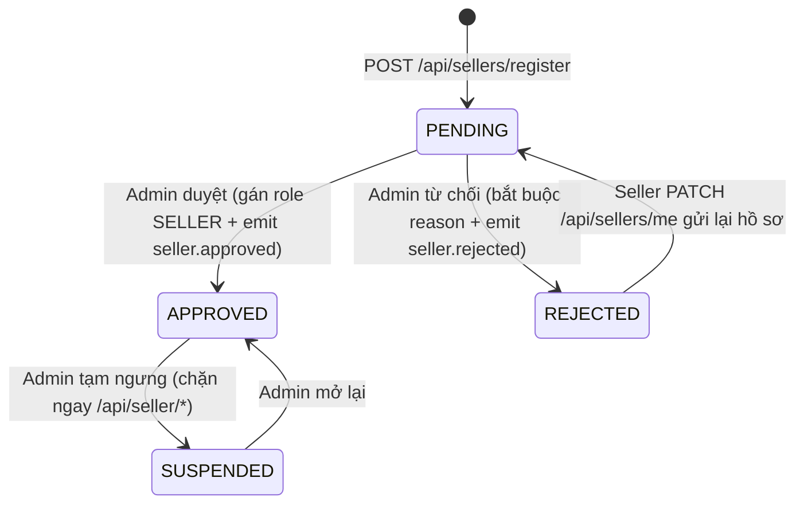

# 14 – T-11, T-12 & T-14 (User, Seller & Seller Product API): tổng kết triển khai

- **Phạm vi:** Hoàn tất toàn bộ phần việc còn lại của **M3 – Backend Core** (đủ **6/6 task P0: T-10 → T-15**):
  - **T-11 – User API** (hồ sơ cá nhân, đổi mật khẩu thu hồi phiên khác, sổ địa chỉ giao hàng).
  - **T-12 – Seller API** (đăng ký bán hàng, duyệt/từ chối/tạm ngưng/mở lại, trang cửa hàng công khai, quản lý cửa hàng/logo và thống kê doanh thu).
  - **T-14 – Product API cho Seller** (CRUD sản phẩm, đổi trạng thái, xóa mềm, quản lý biến thể/tồn kho và ảnh sản phẩm Cloudinary).
- **Nhánh & commit:**
  - `feature/T-11-to-T-15-core-api` (gộp nối tiếp từ `0baaf39` bản sửa lỗi T-10 và `4b67df0` T-13/T-15):
    - `1ea3069`: T-11 User API + validator `@MaxUtf8Bytes(72)` + `TokenService.revokeOtherForUser()`.
    - `37f698f`: T-12 Seller API + `ApprovedSellerGuard` + `@CurrentStore()` + `UploadModule`/`CloudinaryService`.
    - `9480dfa`: T-14 Seller Product API + bộ test E2E tích hợp `users-sellers-products.e2e-spec.ts`.
    - `9343b8c`: bổ sung unit test nâng độ phủ `SellerProductsService` và `CloudinaryService` vượt 70%, kèm commit tài liệu tổng kết này.
- **Thời gian thực hiện:** 26/11/2026.
- **Trạng thái:** đã hoàn thành mã nguồn, unit test (100% service đạt ≥ 74% coverage, vượt mục tiêu NFR-11 ≥ 70%), e2e test ở chế độ CI không `.env`, build cả Backend & Frontend và kiểm chứng live 25/25 kịch bản trên PostgreSQL 16 + Redis 7 thật.

---

## 1. Thành phần nền tảng dùng chung mới bổ sung

| Thành phần | Đường dẫn (`apps/api/`) | Mục đích & quyết định thiết kế |
|---|---|---|
| Giới hạn byte UTF-8 | `src/common/validators/max-utf8-bytes.validator.ts` | Giải quyết hạn chế bcrypt chỉ băm 72 byte đầu với mật khẩu tiếng Việt có dấu (ghi nhận ở [doc 11](11_T-10_Auth_Implementation.md) mục 9). Áp dụng `@MaxUtf8Bytes(72)` cho cả `RegisterDto` (T-10) và `ChangePasswordDto` (T-11). |
| Thu hồi phiên khác | `src/modules/auth/token.service.ts` (`revokeOtherForUser`) | Thu hồi toàn bộ `refresh_tokens` còn hiệu lực của user ngoại trừ hash của refresh token phiên hiện tại trong cùng một Prisma transaction khi đổi mật khẩu. |
| Guard & decorator cửa hàng | `src/common/guards/approved-seller.guard.ts`, `src/common/decorators/current-store.decorator.ts` | Bảo vệ toàn bộ route `/api/seller/*`: chưa đăng nhập → `401 UNAUTHORIZED`; Customer thuần (chưa có hồ sơ seller) → `403 FORBIDDEN` (IT-02); Seller đang `PENDING` / `REJECTED` / `SUSPENDED` → `403 SELLER_NOT_APPROVED` (IT-04). Truy vấn trực tiếp trạng thái seller từ DB nên chặn tức thì seller vừa bị `SUSPENDED` dù JWT chưa hết hạn; gắn `request.sellerStore` để controller lấy qua `@CurrentStore()`. |
| Upload & kiểm tra ảnh | `src/upload/upload.module.ts`, `src/upload/cloudinary.service.ts` | `@Global()` module. Giới hạn bộ nhớ Multer ở 6 MB để ảnh 5–6 MB đi qua `validateImageFile()` và trả chuẩn `400 INVALID_FILE`. Kiểm tra đồng thời kích thước (≤ 5 MB), MIME (`image/jpeg`, `image/png`, `image/webp`) và **magic bytes** (`FF D8 FF`, `89 50 4E 47 0D 0A 1A 0A`, `RIFF....WEBP`) nhằm chặn tệp `.exe` đổi đuôi hoặc `.svg` ([doc 08](08_Testing_Plan.md) mục 6 #10). Không chặn khởi động app khi thiếu biến `CLOUDINARY_*`; chỉ trả `503 SERVICE_UNAVAILABLE` nếu gọi upload khi chưa cấu hình. |

---

## 2. T-11 – User API (`apps/api/src/modules/users/`)

### 2.1 Cấu trúc file

| File | Vai trò |
|---|---|
| `users.controller.ts` | 7 endpoint dưới `@Controller('users')` (mặc định yêu cầu JWT) |
| `users.service.ts` | Nghiệp vụ hồ sơ, đổi mật khẩu kèm thu hồi phiên khác và sổ địa chỉ |
| `dto/update-profile.dto.ts` | Validate `fullName?` (2–100 ký tự), `phone?` (định dạng SĐT Việt Nam `^0[35789]\d{8}$`) |
| `dto/change-password.dto.ts` | Validate `currentPassword`, `newPassword` (≥ 8 ký tự, ≤ 72 byte UTF-8) |
| `dto/address.dto.ts` | DTO tạo, cập nhật và phản hồi địa chỉ (`CreateAddressDto`, `UpdateAddressDto`, `AddressResponseDto`) |
| `users.module.ts` | Import `AuthModule` (dùng `TokenService`), export `UsersService` |
| `users.service.spec.ts` | Unit test service (mock Prisma & `TokenService`) |

### 2.2 Danh sách endpoint (khớp [doc 05](05_API_Documentation.md) mục 4)

| Method | URL | Auth | Kết quả & quy tắc nghiệp vụ |
|---|---|---|---|
| `GET` | `/api/users/me` | JWT | `200` `UserProfileDto` kèm `roles` và `sellerStatus` hiện tại |
| `PATCH` | `/api/users/me` | JWT | `200` cập nhật `fullName`, `phone` (không cho sửa `email`, `roles`, `status`) |
| `PATCH` | `/api/users/me/password` | JWT | `204`; sai mật khẩu hiện tại → `400 WRONG_PASSWORD`; đổi mật khẩu thành công thu hồi mọi refresh token của các phiên khác trong cùng transaction |
| `GET` | `/api/users/me/addresses` | JWT | `200` danh sách địa chỉ của user, ưu tiên địa chỉ mặc định lên đầu |
| `POST` | `/api/users/me/addresses` | JWT | `201` địa chỉ mới; tối đa 10 địa chỉ/user (`400 ADDRESS_LIMIT_REACHED`); địa chỉ đầu tiên tự động là mặc định (`isDefault = true`); tạo mới với `isDefault = true` tự bỏ mặc định các địa chỉ cũ trong transaction |
| `PATCH` | `/api/users/me/addresses/:id` | JWT | `200` cập nhật địa chỉ thuộc sở hữu của user; `400 VALIDATION_ERROR` (UUID sai), `404 ADDRESS_NOT_FOUND` (không tồn tại hoặc thuộc user khác — chống IDOR) |
| `DELETE` | `/api/users/me/addresses/:id` | JWT | `204`; nếu xóa địa chỉ đang là mặc định thì tự động chuyển `isDefault = true` sang địa chỉ mới nhất còn lại (khớp partial unique index `addresses_one_default_per_user_idx`); `404 ADDRESS_NOT_FOUND` nếu thuộc user khác |

---

## 3. T-12 – Seller API (`apps/api/src/modules/sellers/`)

### 3.1 Cấu trúc file

| File | Vai trò |
|---|---|
| `sellers.controller.ts` | `@Controller('sellers')`: đăng ký (`@Roles(Role.CUSTOMER)`), xem và cập nhật hồ sơ người bán của tôi |
| `admin-sellers-status.controller.ts` | `@Controller('admin/sellers')` (`@Roles(Role.ADMIN)`): duyệt, từ chối, tạm ngưng hoặc mở lại người bán |
| `stores.controller.ts` | `@Public()`, `@Controller('stores')`: trang cửa hàng công khai theo `slug` |
| `seller-store.controller.ts` | `@UseGuards(ApprovedSellerGuard)`, `@Controller('seller')`: sửa cửa hàng, tải logo và 3 endpoint thống kê |
| `sellers.service.ts` | Toàn bộ nghiệp vụ hồ sơ seller, state machine duyệt, cửa hàng, upload logo và truy vấn thống kê SQL |
| `dto/register-seller.dto.ts` | Validate đăng ký và cập nhật hồ sơ seller (`RegisterSellerDto`, `UpdateSellerProfileDto`) |
| `dto/update-store.dto.ts` | Validate cập nhật cửa hàng, đổi trạng thái seller (Admin) và query khoảng thời gian thống kê |
| `dto/seller-response.dto.ts` | DTO đầu ra Swagger cho Seller, Store và Stats |
| `sellers.module.ts` | Export `SellersService` và `ApprovedSellerGuard` để `ProductsModule` (T-14), M4 và M1 tái sử dụng |
| `sellers.service.spec.ts` | Unit test service (hồ sơ, state machine, domain event, store, `resolveDateRange`) |

### 3.2 Danh sách endpoint (khớp [doc 05](05_API_Documentation.md) mục 5 & 14.2)

| Method | URL | Auth / Guard | Kết quả & quy tắc nghiệp vụ |
|---|---|---|---|
| `POST` | `/api/sellers/register` | `CUSTOMER` | `201` tạo đồng thời `sellers` (`PENDING`) và `stores` (tự sinh `slug`, gắn hậu tố nếu trùng) trong 1 transaction; đã đăng ký → `409 SELLER_ALREADY_REGISTERED` |
| `GET` | `/api/sellers/me` | JWT | `200` hồ sơ seller kèm `store`; chưa đăng ký → `404 SELLER_NOT_FOUND` |
| `PATCH` | `/api/sellers/me` | JWT | `200` cập nhật hồ sơ khi `PENDING`/`REJECTED`/`APPROVED`; nếu đang `REJECTED` sẽ tự mở lại về `PENDING` và xóa `rejectionReason`; nếu `SUSPENDED` → `409 INVALID_SELLER_STATUS` |
| `PATCH` | `/api/admin/sellers/:id/status` | `ADMIN` | `200` chuyển trạng thái theo state machine; bắt buộc có `reason` khi `REJECTED`/`SUSPENDED`; chuyển sang `APPROVED` tự gán role `SELLER` trong `user_roles` và phát event `seller.approved` (hoặc `seller.rejected`) sau khi transaction commit |
| `GET` | `/api/stores/:slug` | Public | `200` thông tin cửa hàng công khai kèm `productCount` (chỉ đếm sản phẩm `ACTIVE`, `deletedAt IS NULL` thuộc seller `APPROVED`); ngược lại → `404 STORE_NOT_FOUND` |
| `PATCH` | `/api/seller/store` | `ApprovedSellerGuard` | `200` cập nhật tên và mô tả cửa hàng (giữ nguyên `slug` ổn định URL) |
| `POST` | `/api/seller/store/logo` | `ApprovedSellerGuard` | `200` `{ logoUrl }`; kiểm tra file ảnh ≤ 5 MB + magic bytes và tải lên `marketplace/stores` |
| `GET` | `/api/seller/stats/overview` | `ApprovedSellerGuard` | `200` tổng `revenue` (chỉ tính `seller_orders` trạng thái `COMPLETED`), `orderCount`, `pendingOrderCount`, `productCount`, `lowStockCount` (`quantity <= low_stock_threshold`); mặc định 30 ngày gần nhất |
| `GET` | `/api/seller/stats/revenue` | `ApprovedSellerGuard` | `200` doanh thu và số đơn `COMPLETED` gom theo ngày (`YYYY-MM-DD` UTC), giới hạn khoảng tối đa **90 ngày** |
| `GET` | `/api/seller/stats/top-products` | `ApprovedSellerGuard` | `200` top sản phẩm bán chạy (mặc định 5, tối đa 50) từ các đơn `COMPLETED`, dùng `Prisma.sql` tham số hóa 100% |

### 3.3 Vòng đời trạng thái người bán

---

## 4. T-14 – Seller Product API (`apps/api/src/modules/products/`)

### 4.1 Cấu trúc file bổ sung vào `ProductsModule`

| File | Vai trò |
|---|---|
| `seller-products.controller.ts` | 12 endpoint dưới `@Controller('seller/products')`, bảo vệ bởi `@UseGuards(ApprovedSellerGuard)` |
| `seller-products.service.ts` | Nghiệp vụ CRUD sản phẩm, kiểm tra điều kiện publish, biến thể/tồn kho, upload/sắp xếp/xóa ảnh Cloudinary |
| `dto/seller-product.dto.ts` | DTO tạo/sửa sản phẩm, đổi trạng thái, tạo/sửa biến thể, sắp xếp ảnh và lọc danh sách sản phẩm của seller |
| `dto/product-response.dto.ts` | Bổ sung `SellerProductSummaryDto`, `SellerProductDetailDto`, `SellerProductVariantDto`, `ProductImageDto` |
| `products.module.ts` | Import thêm `SellersModule`, đăng ký & export `SellerProductsService` |
| `seller-products.service.spec.ts` | Unit test đầy đủ cho CRUD, publish, biến thể, ảnh, rollback Cloudinary và chống IDOR |

### 4.2 Danh sách endpoint (khớp [doc 05](05_API_Documentation.md) mục 7.2)

| Method | URL | Auth / Guard | Kết quả & quy tắc nghiệp vụ |
|---|---|---|---|
| `GET` | `/api/seller/products` | `ApprovedSellerGuard` | `200` `Paginated<SellerProductSummaryDto>` lọc theo `status`, `q`, `page`, `limit` (mọi trạng thái chưa xóa mềm của riêng cửa hàng) |
| `GET` | `/api/seller/products/:id` | `ApprovedSellerGuard` | `200` `SellerProductDetailDto` đầy đủ biến thể (kể cả `isActive = false`) và tồn kho; `404 PRODUCT_NOT_FOUND` nếu không thuộc store (IT-05) |
| `POST` | `/api/seller/products` | `ApprovedSellerGuard` | `201` tạo sản phẩm ở trạng thái `DRAFT` kèm 1–30 biến thể và bản ghi `inventory` trong 1 transaction; kiểm tra danh mục lá qua `CategoriesService.assertLeafCategory()` (`400 CATEGORY_NOT_LEAF`, `404 CATEGORY_NOT_FOUND`), chặn trùng SKU (`409 DUPLICATE_SKU`), tự tính `minPrice` |
| `PATCH` | `/api/seller/products/:id` | `ApprovedSellerGuard` | `200` cập nhật `name`, `description`, `categoryId` (vẫn kiểm tra danh mục lá); chặn nếu sản phẩm `BANNED` (`403 PRODUCT_BANNED`) |
| `PATCH` | `/api/seller/products/:id/status` | `ApprovedSellerGuard` | `200` đổi `DRAFT` / `ACTIVE` / `HIDDEN`; chuyển sang `ACTIVE` yêu cầu ≥ 1 ảnh và ≥ 1 biến thể đang bật (`400 PRODUCT_NOT_PUBLISHABLE`); chặn sản phẩm `BANNED` (`403 PRODUCT_BANNED`) |
| `DELETE` | `/api/seller/products/:id` | `ApprovedSellerGuard` | `204` xóa mềm (`deletedAt = now()`); tự động ẩn khỏi mọi API công khai và danh sách seller |
| `POST` | `/api/seller/products/:id/variants` | `ApprovedSellerGuard` | `201` thêm biến thể mới + bản ghi `inventory`, kiểm tra trần 30 biến thể, chặn trùng SKU (`409 DUPLICATE_SKU`), tính lại `minPrice` |
| `PATCH` | `/api/seller/products/:id/variants/:variantId` | `ApprovedSellerGuard` | `200` cập nhật `sku`, `name`, `attributes`, `price`, `isActive`; chặn tắt biến thể active cuối cùng (`400 LAST_ACTIVE_VARIANT`), chặn trùng SKU (`409 DUPLICATE_SKU`), tính lại `minPrice` |
| `DELETE` | `/api/seller/products/:id/variants/:variantId` | `ApprovedSellerGuard` | `204`; chặn xóa nếu biến thể đã phát sinh `order_items` (`409 VARIANT_HAS_ORDERS`, kèm bắt `P2003`) hoặc là biến thể active cuối cùng (`400 LAST_ACTIVE_VARIANT`), tính lại `minPrice` |
| `POST` | `/api/seller/products/:id/images` | `ApprovedSellerGuard` | `201` tải nhiều ảnh (trường `files`), giới hạn tổng tối đa 8 ảnh/sản phẩm (`400 IMAGE_LIMIT_REACHED`); validate toàn bộ file trước khi gọi Cloudinary; nếu lỗi giữa chừng hoặc lỗi ghi DB tự dọn ảnh đã upload lên Cloudinary (best-effort) |
| `PATCH` | `/api/seller/products/:id/images/order` | `ApprovedSellerGuard` | `200` cập nhật `sortOrder` theo `imageIds[]` (ảnh đầu là ảnh đại diện); yêu cầu danh sách khớp đầy đủ và không trùng lặp với ảnh hiện có (`400 VALIDATION_ERROR`) |
| `DELETE` | `/api/seller/products/:id/images/:imageId` | `ApprovedSellerGuard` | `204` xóa bản ghi DB và gọi xóa best-effort trên Cloudinary; `404 IMAGE_NOT_FOUND` nếu ảnh không thuộc sản phẩm |

---

## 5. Kết quả kiểm thử toàn diện toàn hệ thống

### 5.1 Kiểm thử tự động (Backend, Frontend & Docker)

| Hạng mục | Lệnh kiểm tra | Kết quả |
|---|---|---|
| Prisma Schema & Client | `npx prisma validate && npx prisma generate` | ✅ Pass |
| Backend Lint | `npm run lint:check` (`apps/api`) | ✅ Pass (0 lỗi, 0 cảnh báo) |
| Backend Typecheck | `npm run typecheck` (`apps/api`) | ✅ Pass |
| Backend Unit + Coverage | `npm run test:cov -- --maxWorkers=2` (`apps/api`) | ✅ **21/21 suites, 194/194 tests Pass** |
| Backend E2E (chế độ CI không `.env`) | `npm run test:e2e` (tạm ẩn `.env`, chạy qua `configureApp`) | ✅ **4/4 suites, 41/41 tests Pass** (`app`, `categories`, `products`, `users-sellers-products`) |
| Backend Build | `npm run build` (`apps/api`) | ✅ Pass |
| Frontend Lint | `npm run lint` (`apps/web`) | ✅ Pass |
| Frontend Typecheck | `npm run typecheck` (`apps/web`) | ✅ Pass (`next typegen && tsc --noEmit`) |
| Frontend Build | `npm run build` (`apps/web`) | ✅ Pass (Next.js 16.4.6 Turbopack) |
| Docker Compose | `docker compose config -q` | ✅ Pass |

### 5.2 Độ phủ unit test tầng service (đối chiếu NFR-11 ≥ 70%)

Mọi service trong `apps/api/src` đều đạt độ phủ statements và lines trên 74%:

| File | % Stmts | % Branch | % Funcs | % Lines | Đạt NFR-11 (≥ 70%) |
|---|---:|---:|---:|---:|:---:|
| `src/modules/auth/token.service.ts` | 95.91% | 66.66% | 90.00% | 95.74% | ✅ |
| `src/modules/categories/categories.service.ts` | 90.47% | 80.95% | 100.00% | 89.87% | ✅ |
| `src/modules/auth/auth.service.ts` | 90.00% | 88.23% | 93.33% | 89.47% | ✅ |
| `src/modules/products/seller-products.service.ts` | 87.76% | 54.44% | 97.29% | 87.29% | ✅ |
| `src/modules/products/products.service.ts` | 86.13% | 72.30% | 95.00% | 86.31% | ✅ |
| `src/redis/redis.service.ts` | 86.00% | 76.19% | 75.00% | 85.41% | ✅ |
| `src/modules/users/users.service.ts` | 80.00% | 57.14% | 82.35% | 79.45% | ✅ |
| `src/prisma/prisma.service.ts` | 77.27% | 25.00% | 66.66% | 75.00% | ✅ |
| `src/upload/cloudinary.service.ts` | 76.92% | 73.17% | 71.42% | 76.00% | ✅ |
| `src/modules/sellers/sellers.service.ts` | 74.57% | 55.55% | 59.09% | 75.22% | ✅ |
| `src/common/guards/approved-seller.guard.ts` | 95.45% | 83.33% | 100.00% | 95.00% | ✅ |
| `src/common/filters/http-exception.filter.ts` | 97.82% | 90.47% | 100.00% | 97.72% | ✅ |

*(Các file cấu hình, guard, pipe, interceptor và utility nền tảng khác như `jwt-auth.guard.ts`, `roles.guard.ts`, `validation.pipe.ts`, `response.interceptor.ts`, `env.validation.ts`, `slugify.ts`, `paginated.ts` đều đạt 100% statements.)*

### 5.3 Kiểm thử live trên PostgreSQL 16 + Redis 7 thật (25/25 kịch bản pass)

Chạy server NestJS thật kết nối tới container `marketplace_postgres` (`:5432`) và `marketplace_redis` (`:6379`) với dữ liệu seed thật:

- **Chuỗi T-11 (User API):**
  - Cập nhật hồ sơ hợp lệ (`PATCH /api/users/me`), chặn số điện thoại sai định dạng (`400 VALIDATION_ERROR`).
  - Đăng nhập 2 phiên song song → đổi mật khẩu (`PATCH /api/users/me/password`, `204`) → xác nhận phiên còn lại bị thu hồi ngay (`POST /api/auth/refresh` → `401 INVALID_REFRESH_TOKEN`), phiên hiện tại vẫn hoạt động bình thường.
  - Sổ địa chỉ: tạo địa chỉ đầu tiên tự gán `isDefault = true`, tạo địa chỉ thứ 2 đặt mặc định tự bỏ mặc định địa chỉ 1, xóa địa chỉ mặc định tự chuyển mặc định về địa chỉ còn lại, truy cập địa chỉ của user khác bị chặn (`404 ADDRESS_NOT_FOUND`).
- **Chuỗi T-12 (Seller API & IT-04):**
  - Customer đăng ký bán hàng (`POST /api/sellers/register` → `201 PENDING`, tạo kèm `store`).
  - **IT-04:** Seller ở trạng thái `PENDING` gọi `GET /api/seller/products` bị chặn `403 SELLER_NOT_APPROVED`.
  - Admin duyệt (`PATCH /api/admin/sellers/:id/status` → `APPROVED`) → user gọi `POST /api/auth/refresh` nhận ngay role `SELLER` trong JWT mới.
  - Trang cửa hàng công khai `GET /api/stores/:slug` trả `200` kèm `productCount`; `PATCH /api/seller/store` cập nhật thành công.
  - Cả 3 endpoint thống kê (`overview`, `revenue`, `top-products`) thực thi SQL trực tiếp trên PostgreSQL thật trả `200` chuẩn dữ liệu; `revenue` vượt quá 90 ngày bị chặn `400 VALIDATION_ERROR`.
- **Chuỗi T-14 (Seller Product API, IT-03 & IT-05):**
  - **IT-03:** Tạo sản phẩm mới ở trạng thái `DRAFT` kèm 2 biến thể và tồn kho (`201`, `minPrice` tự tính đúng); chặn gán danh mục cha (`400 CATEGORY_NOT_LEAF`); chặn publish `ACTIVE` khi chưa có ảnh (`400 PRODUCT_NOT_PUBLISHABLE`).
  - Thêm/sửa/xóa biến thể cập nhật lại `minPrice` chính xác; chặn trùng SKU (`409 DUPLICATE_SKU`) và chặn xóa/tắt biến thể active cuối cùng (`400 LAST_ACTIVE_VARIANT`).
  - Upload ảnh: gửi tệp `.exe` đổi đuôi sang `.jpg` bị chặn ở bước kiểm tra magic bytes (`400 INVALID_FILE`); gửi PNG hợp lệ khi chưa khai báo biến `CLOUDINARY_*` trả `503 SERVICE_UNAVAILABLE` an toàn.
  - **IT-05 (IDOR):** Seller B truy cập/sửa/xóa sản phẩm của Seller A nhận `404 PRODUCT_NOT_FOUND`.
  - Xóa mềm (`DELETE /api/seller/products/:id` → `204`) làm sản phẩm biến mất khỏi cả danh sách seller lẫn API công khai; dữ liệu thử nghiệm được dọn sạch hoàn toàn sau khi kiểm thử.
- **Tái kiểm chứng toàn bộ nền tảng T-10, T-13, T-15 (21/21 pass):**
  - Health, Swagger `/api/docs`, toàn bộ luồng Auth (xoay vòng refresh token, phát hiện dùng lại token, chặn user `BANNED`, giới hạn 429 ở lần đăng nhập thứ 11).
  - Cache Redis thật cho `GET /api/categories` (`TTL = 600s`) và tự xóa cache khi Admin thay đổi danh mục.
  - Tìm kiếm tiếng Việt không dấu **IT-18** (`q=ao+thun`, `q=noi+chien`), chống SQL injection (`q=' OR 1=1 --`), lọc 34 sản phẩm `ACTIVE` và ẩn sản phẩm `HIDDEN`.

---

## 6. Lưu ý cấu hình & bàn giao cho các bước tiếp theo

- **Cấu hình Cloudinary khi cần tải ảnh thật:** điền 3 biến `CLOUDINARY_CLOUD_NAME`, `CLOUDINARY_API_KEY`, `CLOUDINARY_API_SECRET` vào `apps/api/.env` (mẫu đã có sẵn trong `apps/api/.env.example`). Khi để trống ở môi trường phát triển cục bộ hoặc CI, hệ thống vẫn khởi động và chạy kiểm thử bình thường.
- **Mở khóa các module phụ thuộc:**
  - **M4 – Commerce & Orders (T-16 → T-20):** tái sử dụng `ApprovedSellerGuard` và `@CurrentStore()` cho các endpoint `/api/seller/inventory/*`, `/api/seller/orders/*`; bảng `inventory` đã được T-14 khởi tạo đồng bộ ngay khi tạo biến thể.
  - **M1 – Notification & Admin (T-21, T-22):** lắng nghe 2 domain event `seller.approved` và `seller.rejected` (T-21); tái sử dụng trực tiếp `SellersService.updateSellerStatus()` và `TokenService.revokeAllForUser()` trong `AdminModule` (T-22).
  - **M2 – Frontend (T-23 → T-27):** toàn bộ hợp đồng API Auth, User, Address, Seller, Store, Category, Product & Search đã sẵn sàng và có tài liệu đầy đủ tại `/api/docs`.
